# Граф крейтов workspace

> **Файл генерируется.** Блок между маркерами пересобирает `just docs::crate-graph`
> (скрипт [`scripts/crate_graph.py`](scripts/crate_graph.py) читает `cargo metadata`).
> CI ([`docs.yml`](../../.github/workflows/docs.yml)) запускает `just docs::crate-graph-check` и падает, если граф устарел.
> Руками блок не правят: добавили крейт или зависимость между крейтами — перегенерируйте и закоммитьте.

Показаны только связи между крейтами workspace: сплошная стрелка — обычная зависимость, пунктир — `dev` или `build`. Внешние крейты только подсчитаны в таблице. Целевой (запланированный) состав ядра — в [architecture.md §4](architecture.md#4-ядро-целевой-состав-крейтов).

```mermaid
flowchart LR
  subgraph g0["core/crates — ядро"]
    pa_anime_mappings["pa-anime-mappings"]
    pa_catalog["pa-catalog"]
    pa_discovery["pa-discovery"]
    pa_ffi["pa-ffi"]
    pa_flavor["pa-flavor"]
    pa_frb["pa-frb"]
    pa_imagecache["pa-imagecache"]
    pa_jellyfin["pa-jellyfin"]
    pa_jobs["pa-jobs"]
    pa_library["pa-library"]
    pa_log["pa-log"]
    pa_metadata["pa-metadata"]
    pa_model["pa-model"]
    pa_offline["pa-offline"]
    pa_pairing["pa-pairing"]
    pa_playback["pa-playback"]
    pa_player_io["pa-player-io"]
    pa_probe["pa-probe"]
    pa_proxy["pa-proxy"]
    pa_recognition["pa-recognition"]
    pa_remote_config["pa-remote-config"]
    pa_runtime["pa-runtime"]
    pa_scanner["pa-scanner"]
    pa_secrets["pa-secrets"]
    pa_skip["pa-skip"]
    pa_smb2["pa-smb2"]
    pa_sources["pa-sources"]
    pa_storage["pa-storage"]
    pa_subsonic["pa-subsonic"]
    pa_sync["pa-sync"]
    pa_trickplay["pa-trickplay"]
    pa_twitch["pa-twitch"]
    pa_twitch_archive["pa-twitch-archive"]
    pa_twitch_chat["pa-twitch-chat"]
    pa_twitch_live["pa-twitch-live"]
    pa_update["pa-update"]
    pa_vfs["pa-vfs"]
    pa_vfs_ftp["pa-vfs-ftp"]
    pa_vfs_sftp["pa-vfs-sftp"]
    pa_vfs_smb["pa-vfs-smb"]
    pa_vfs_webdav["pa-vfs-webdav"]
  end
  subgraph g1["server — медиасервер"]
    pa_server["pa-server"]
  end
  subgraph g2["tools — инструменты"]
    pa_eval["pa-eval"]
    pa_recognition_eval["pa-recognition-eval"]
  end
  pa_catalog --> pa_anime_mappings
  pa_catalog -. dev .-> pa_discovery
  pa_catalog --> pa_jobs
  pa_catalog --> pa_library
  pa_catalog --> pa_metadata
  pa_catalog --> pa_model
  pa_catalog --> pa_probe
  pa_catalog --> pa_proxy
  pa_catalog --> pa_recognition
  pa_catalog --> pa_scanner
  pa_catalog --> pa_secrets
  pa_catalog --> pa_sources
  pa_catalog -. dev .-> pa_sync
  pa_catalog --> pa_sync
  pa_catalog --> pa_vfs
  pa_eval --> pa_anime_mappings
  pa_eval --> pa_catalog
  pa_eval --> pa_recognition
  pa_eval --> pa_recognition_eval
  pa_eval --> pa_scanner
  pa_ffi --> pa_discovery
  pa_ffi --> pa_flavor
  pa_ffi --> pa_playback
  pa_ffi --> pa_runtime
  pa_ffi --> pa_secrets
  pa_frb --> pa_catalog
  pa_frb --> pa_discovery
  pa_frb --> pa_ffi
  pa_frb -. build .-> pa_flavor
  pa_frb --> pa_flavor
  pa_frb --> pa_imagecache
  pa_frb --> pa_jobs
  pa_frb --> pa_library
  pa_frb --> pa_log
  pa_frb --> pa_model
  pa_frb --> pa_offline
  pa_frb --> pa_probe
  pa_frb --> pa_proxy
  pa_frb --> pa_recognition
  pa_frb --> pa_remote_config
  pa_frb --> pa_secrets
  pa_frb --> pa_skip
  pa_frb --> pa_sources
  pa_frb --> pa_storage
  pa_frb --> pa_sync
  pa_frb --> pa_trickplay
  pa_frb -. dev .-> pa_twitch
  pa_frb --> pa_twitch
  pa_frb --> pa_twitch_archive
  pa_frb --> pa_twitch_chat
  pa_frb --> pa_twitch_live
  pa_frb --> pa_update
  pa_frb --> pa_vfs
  pa_jellyfin -. dev .-> pa_trickplay
  pa_jellyfin --> pa_vfs
  pa_jobs --> pa_library
  pa_library --> pa_model
  pa_library --> pa_recognition
  pa_metadata --> pa_recognition
  pa_offline --> pa_catalog
  pa_offline --> pa_jobs
  pa_offline --> pa_library
  pa_offline -. dev .-> pa_proxy
  pa_offline -. dev .-> pa_secrets
  pa_offline -. dev .-> pa_sources
  pa_offline --> pa_storage
  pa_offline --> pa_vfs
  pa_pairing --> pa_secrets
  pa_playback --> pa_model
  pa_player_io --> pa_vfs
  pa_probe --> pa_library
  pa_probe --> pa_player_io
  pa_probe --> pa_vfs
  pa_proxy --> pa_vfs
  pa_recognition --> pa_anime_mappings
  pa_scanner --> pa_library
  pa_scanner -. dev .-> pa_model
  pa_scanner --> pa_vfs
  pa_server --> pa_discovery
  pa_server --> pa_library
  pa_server --> pa_model
  pa_server --> pa_pairing
  pa_server --> pa_runtime
  pa_server --> pa_secrets
  pa_server --> pa_sync
  pa_skip --> pa_library
  pa_skip --> pa_probe
  pa_skip --> pa_vfs
  pa_sources --> pa_jellyfin
  pa_sources --> pa_library
  pa_sources -. dev .-> pa_model
  pa_sources --> pa_secrets
  pa_sources --> pa_subsonic
  pa_sources --> pa_sync
  pa_sources --> pa_vfs
  pa_sources --> pa_vfs_ftp
  pa_sources --> pa_vfs_sftp
  pa_sources --> pa_vfs_smb
  pa_sources --> pa_vfs_webdav
  pa_storage --> pa_jobs
  pa_storage --> pa_library
  pa_subsonic --> pa_vfs
  pa_sync --> pa_discovery
  pa_sync --> pa_library
  pa_sync --> pa_model
  pa_sync --> pa_pairing
  pa_sync -. dev .-> pa_secrets
  pa_sync --> pa_secrets
  pa_trickplay --> pa_probe
  pa_trickplay --> pa_vfs
  pa_trickplay -. dev .-> pa_vfs_smb
  pa_twitch -. build .-> pa_flavor
  pa_twitch --> pa_flavor
  pa_twitch --> pa_library
  pa_twitch --> pa_model
  pa_twitch --> pa_remote_config
  pa_twitch --> pa_secrets
  pa_twitch -. dev .-> pa_twitch
  pa_twitch_archive -. build .-> pa_flavor
  pa_twitch_archive --> pa_flavor
  pa_twitch_archive --> pa_jobs
  pa_twitch_archive -. dev .-> pa_library
  pa_twitch_archive --> pa_library
  pa_twitch_archive -. dev .-> pa_model
  pa_twitch_archive --> pa_model
  pa_twitch_archive --> pa_probe
  pa_twitch_archive -. dev .-> pa_remote_config
  pa_twitch_archive --> pa_storage
  pa_twitch_archive -. dev .-> pa_twitch
  pa_twitch_archive --> pa_twitch
  pa_twitch_archive -. dev .-> pa_twitch_archive
  pa_twitch_archive --> pa_twitch_chat
  pa_twitch_archive --> pa_twitch_live
  pa_twitch_archive --> pa_vfs
  pa_twitch_chat --> pa_imagecache
  pa_twitch_chat -. dev .-> pa_twitch
  pa_twitch_chat --> pa_twitch
  pa_twitch_chat -. dev .-> pa_twitch_chat
  pa_twitch_live -. dev .-> pa_library
  pa_twitch_live --> pa_library
  pa_twitch_live -. dev .-> pa_twitch
  pa_twitch_live --> pa_twitch
  pa_twitch_live --> pa_twitch_chat
  pa_twitch_live -. dev .-> pa_twitch_live
  pa_update --> pa_remote_config
  pa_vfs_ftp --> pa_discovery
  pa_vfs_ftp --> pa_vfs
  pa_vfs_sftp --> pa_vfs
  pa_vfs_smb --> pa_smb2
  pa_vfs_smb --> pa_vfs
  pa_vfs_webdav --> pa_discovery
  pa_vfs_webdav --> pa_vfs
```

<!-- BEGIN GENERATED: crate-graph -->

| Крейт | Каталог | Внешних зависимостей | Описание |
|---|---|---|---|
| `pa-anime-mappings` | `core/crates/pa-anime-mappings` | 5 | Anime cross-ID and episode mappings: bundled ODbL data plus runtime-downloaded upstream lists (META-008) |
| `pa-catalog` | `core/crates/pa-catalog` | 5 | Client media library on the Rust core: scan pipeline (pa-scanner, music tags, fingerprints, local recognition with pa-recognition), provider metadata (pa-metadata), item views, progress and the pa_library v0 import (UI-024), change watcher (LIB-005), sources through pa-vfs connectors and the playback opener (LIB-018) |
| `pa-discovery` | `core/crates/pa-discovery` | 4 | LAN discovery over mDNS/DNS-SD: own servers, sync peers, SMB, WebDAV and NFS shares; platform browser hook (NET-009) |
| `pa-eval` | `tools/crates/pa-eval` | 2 | Offline eval runner for the recognition corpus: metrics, reports, regression check (META-003) |
| `pa-ffi` | `core/crates/pa-ffi` | 3 | UniFFI facade of the project_alpha core: one API for Kotlin and Swift |
| `pa-flavor` | `core/crates/pa-flavor` | 0 | Build flavors store and full (ADR-0007, CORE-013): cargo features, the workspace-wide Rust cfg and the runtime flavor query |
| `pa-frb` | `core/crates/pa-frb` | 3 | flutter_rust_bridge facade of the project_alpha core for the Dart package pa_core |
| `pa-imagecache` | `core/crates/pa-imagecache` | 3 | Disk LRU cache of provider artwork (posters, backdrops, stills) with provider size variants and offline use (LIB-013) |
| `pa-jellyfin` | `core/crates/pa-jellyfin` | 4 | Jellyfin and Emby client (NET-014, NET-015): sign-in (password, Quick Connect on Jellyfin), users, libraries, Continue Watching, favorites, secondary addresses, playback reports, DirectPlay/DirectStream/HLS transcode, trickplay or BIF previews, and the server's libraries as a read-only pa-vfs tree |
| `pa-jobs` | `core/crates/pa-jobs` | 2 | Persistent job queue of the core: priorities, per-type concurrency limits, retries with backoff, pause and cancel, progress events, survives restart (CORE-011) |
| `pa-library` | `core/crates/pa-library` | 3 | Media library storage: SQLite schema v1, embedded migrations, connection setup (LIB-001); progress, Continue watching and Up Next (LIB-011); music library (MUS-001); Twitch data model (TWI-007); FTS5 search (LIB-008); profiles and parental-control filters (LIB-012) |
| `pa-log` | `core/crates/pa-log` | 4 | Opt-in local logs with rotation and redaction, crash capture and the diagnostic report zip (CORE-008) |
| `pa-metadata` | `core/crates/pa-metadata` | 5 | Metadata provider clients outside the sans-IO core: TMDB, AniList, Shikimori, MusicBrainz, Cover Art Archive, rate limiting, ProviderCache (META-009, META-010, META-021) |
| `pa-model` | `core/crates/pa-model` | 1 | Domain types of the project_alpha core: media entities, sync keys, playback state |
| `pa-offline` | `core/crates/pa-offline` | 3 | Offline copies of library items on the device: resumable copies from network sources through pa-jobs and pa-storage, linked to the source file (NET-019) |
| `pa-pairing` | `core/crates/pa-pairing` | 11 | Device family of Kinolune: device keys, pairing by code or QR (SPAKE2), trust store, revocation and family key rotation (SYNC-005) |
| `pa-playback` | `core/crates/pa-playback` | 2 | PlayerEngine contract, capability matrix and Auto engine selection, mock engine and engine contract tests (PLAY-003); playback session with progress saves and Up Next (PLAY-005) |
| `pa-player-io` | `core/crates/pa-player-io` | 0 | ByteSource adapters for players: FFmpeg AVIOContext callbacks and the mpv stream_cb protocol (NET-008) |
| `pa-probe` | `core/crates/pa-probe` | 3 | Container analysis over libavformat (LGPL FFmpeg loaded at run time) through pa-vfs: duration, codecs, HDR and Dolby Vision, audio, subtitles, chapters, tags, attachments (LIB-006) |
| `pa-proxy` | `core/crates/pa-proxy` | 1 | Loopback HTTP Range server that streams any pa-vfs ByteSource to players that only take a URL (NET-007) |
| `pa-recognition` | `core/crates/pa-recognition` | 3 | Media recognition core (sans-IO): filename parser with N-best hypotheses, title normalization and local title index, Provider boundary |
| `pa-recognition-eval` | `tools/recognition-eval` | 2 | Recognition test-corpus format: JSON Schema, taxonomy and validator (META-001) |
| `pa-remote-config` | `core/crates/pa-remote-config` | 5 | Serverless remote config: minisign-signed JSON from the public repo, ETag, disk cache, built-in fallback, kill-switches (CORE-014) |
| `pa-runtime` | `core/crates/pa-runtime` | 6 | Core runtime of project_alpha: async runtime, lifecycle, data directories, settings store |
| `pa-scanner` | `core/crates/pa-scanner` | 1 | Shallow incremental library scan over pa-vfs into pa-library: listing, (path, size, mtime) diff, soft delete with grace period (LIB-003); music tags and index (MUS-001); structural folder analysis (LIB-007) |
| `pa-secrets` | `core/crates/pa-secrets` | 12 | Secret storage of project_alpha: OS keychains, platform callbacks, encrypted-file fallback, log redaction |
| `pa-server` | `server` | 12 | Kinolune media server (mode B): axum HTTP on top of the core crates |
| `pa-skip` | `core/crates/pa-skip` | 3 | Intro and credits detection for series: own audio fingerprints matched across a season, credits from black frames and text on black, chapter names, imported Plex/Jellyfin/EDL markers; segments stored in pa-library (PLAY-011, PLAY-015) |
| `pa-smb2` | `core/crates/pa-smb2` | 1 | Safe Rust wrapper over libsmb2 (LGPL-2.1+) loaded at run time as a shared library (NET-002) |
| `pa-sources` | `core/crates/pa-sources` | 4 | Source manager: local, SMB, WebDAV, Jellyfin, Emby and Subsonic sources in the library database, passwords in the OS secret store, status, connection check and speed test (NET-011), sync of the source list with E2E-sealed passwords (SYNC-010) |
| `pa-storage` | `core/crates/pa-storage` | 3 | Storage targets of the core: quotas, free-space reserve and monitoring, retention rules with a 7-day trash, atomic tmp to final moves (CORE-012) |
| `pa-subsonic` | `core/crates/pa-subsonic` | 6 | Subsonic and OpenSubsonic client (NET-016): token, password and API key auth, artists, albums, tracks, cover art, raw streaming with byte ranges, scrobbles, and the server's music as a read-only pa-vfs tree |
| `pa-sync` | `core/crates/pa-sync` | 17 | Serverless state sync: hybrid logical clock, sync operations, LWW merge, the SQLite outbox (SYNC-001) and the LAN P2P transport (SYNC-006) |
| `pa-trickplay` | `core/crates/pa-trickplay` | 3 | Trickplay seek previews: keyframe thumbnails through runtime-loaded LGPL FFmpeg over pa-vfs, BIF and Jellyfin trickplay readers, disk LRU cache (PLAY-009) |
| `pa-twitch` | `core/crates/pa-twitch` | 7 | Twitch Helix API client (TWI-001), Device Code Flow sign-in (TWI-002) and playback decision with native GQL/usher HLS in full builds (TWI-004) plus low-latency live with ads as is (TWI-006); VOD chapters and categories (TWI-008) |
| `pa-twitch-archive` | `core/crates/pa-twitch-archive` | 6 | Twitch VOD downloader (TWI-017) and live recorder (TWI-018) of full builds: parallel HLS segments with a resumable bitmap, stream-copy remux into MKV/MP4 over the runtime-loaded LGPL FFmpeg, ffmetadata tags and chapters, attachments and sidecars; a pa-jobs job behind the pa-storage gate |
| `pa-twitch-chat` | `core/crates/pa-twitch-chat` | 11 | Twitch live chat (TWI-010): ChatSource over anonymous IRC WebSocket or EventSub WebSocket + Helix, normalised ChatMessage model; emotes and badges as renderable fragments with a disk image cache (TWI-011); viewer filters and sending (TWI-024) |
| `pa-twitch-live` | `core/crates/pa-twitch-live` | 4 | "X is live" without a cloud (TWI-009): EventSub WebSocket within the subscription-cost budget, battery-aware polling of GET /streams as the fallback, a notification gate with per-channel toggles; feeds the VOD chapter tracker (TWI-008) |
| `pa-update` | `core/crates/pa-update` | 2 | Verification of in-app update downloads: SHA256SUMS and the optional minisign signature of a GitHub release (PKG-018) |
| `pa-vfs` | `core/crates/pa-vfs` | 0 | Virtual file system of media sources: Vfs and ByteSource traits, local backend, backend contract tests |
| `pa-vfs-ftp` | `core/crates/pa-vfs-ftp` | 3 | FTP and FTPS backend of pa-vfs: suppaftp, explicit and implicit TLS with certificate pinning, REST for seeks, connection pool (NET-006) |
| `pa-vfs-sftp` | `core/crates/pa-vfs-sftp` | 4 | SFTP backend of pa-vfs: russh + russh-sftp, host key pinned on first use (TOFU), password, keyboard-interactive and key auth, pipelined positional reads (NET-006) |
| `pa-vfs-smb` | `core/crates/pa-vfs-smb` | 0 | SMB2/3 backend of pa-vfs over libsmb2: NTLMSSP, signing, SMB3 encryption, pooled connections, read-ahead with parallel prefetch (NET-003) |
| `pa-vfs-webdav` | `core/crates/pa-vfs-webdav` | 7 | WebDAV backend of pa-vfs: PROPFIND listing, Range reads with read-ahead, Basic and Digest auth, redirects, TLS pinning (NET-004) |

<!-- END GENERATED: crate-graph -->
