<!-- SPDX-License-Identifier: MPL-2.0 -->

# База медиатеки (SQLite), схема v1

Схема принадлежит крейту [`pa-library`](../../core/crates/pa-library) (`LIB-001`). Одна и та же схема используется клиентами (режим A, база на устройстве) и медиасервером (режим B). Решение и альтернативы — [ADR-0013](../adr/0016-library-sqlite-schema-refinery.md); модель данных — [03 §5](../research/03-metadata-recognition.md#5-модель-данных); устройство ядра — [04 §1.3–1.5](../research/04-backend-architecture-billing.md).

Источник истины — SQL-файлы в [`core/crates/pa-library/migrations/`](../../core/crates/pa-library/migrations). Этот документ описывает смысл таблиц; тест `every_table_is_documented` падает, если у таблицы нет раздела здесь.

## Подключение

```rust
let conn = pa_library::open(path)?;   // создаёт файл, настраивает, мигрирует
let mem = pa_library::open_in_memory()?;
```

`open` выставляет на каждом соединении:

| PRAGMA | Значение | Зачем |
|---|---|---|
| `journal_mode` | `WAL` | читатели не блокируют писателя; хранится в файле |
| `foreign_keys` | `ON` | в SQLite по умолчанию выключены; **ставится на каждое соединение** (`pa_library::configure`) |
| `synchronous` | `NORMAL` | в режиме WAL безопасно при сбое процесса, быстрее `FULL` |
| `busy_timeout` | 5 с | второй писатель ждёт, а не получает `SQLITE_BUSY` |

SQLite собирается из исходников (`rusqlite` с `bundled`, public domain), поэтому версия одинакова на всех платформах, и доступны `STRICT`-таблицы и `json_valid()`.

## Миграции

- Раннер свой, ~80 строк в `pa-library` (`migrate`); refinery убран в `LIB-016` из-за уязвимого встроенного SQLite (ADR-0016, поправка).
- Файлы `migrations/YYYYMMDDHHMM_<ID>_<slug>.sql`. Метка времени — номер версии миграции, поэтому ветки, слитые в любом порядке, не требуют перенумерации. `PRAGMA user_version` не используется: 32-битное поле не вмещает метку времени.
- Новый файл добавляется в список `MIGRATIONS` (`src/migrations.rs`); тест сверяет список с каталогом.
- Применённую миграцию **не редактируют**: история `pa_schema_history` (`version`, `name`, `applied_on`, `checksum`) хранит контрольную сумму SQL (FNV-1a 64), и `migrate` откажется работать (`Error::ChecksumMismatch`).
- Все ожидающие миграции применяются **одной транзакцией**: сбой посередине не оставляет полусхему.
- Проверки истории перед запуском:
  - в файле есть таблицы, но нет истории → `Error::ForeignDatabase` (в том числе база pa_library v0), файл не меняется;
  - в истории есть неизвестная версия старше нашей последней → `Error::UnknownMigration` (истории разошлись);
  - наша миграция старше последней применённой, но не применена → `Error::OutOfOrder` (переименуйте файл в более позднюю метку);
  - в истории есть версии новее наших → база от более новой сборки: работаем, `MigrationReport::db_is_newer = true`. Это допустимо благодаря правилу expand→contract (`LIB-002`): новая версия только добавляет, удаление — через версию.
- Изменения схемы — только expand→contract (`LIB-002`). Новая миграция только добавляет таблицы, колонки и индексы; `DROP TABLE`, `DROP COLUMN` и `RENAME` — только в миграции с именем на `_contract`, на релиз позже кода, который перестал их читать. Тест `tests/migration_policy.rs` поднимает базу каждой прошлой версии (каждый префикс `MIGRATIONS`), обновляет её до последней, сверяет схему со свежей базой и проверяет, что таблицы и колонки старых версий на месте. Пересборку таблицы (SQLite не умеет `ALTER … DROP CONSTRAINT`) делают внутри транзакции с `PRAGMA defer_foreign_keys = ON`.

## Соглашения

- Имена таблиц — во множественном числе, `snake_case` (так `matches` не конфликтует с оператором `MATCH`).
- Все таблицы `STRICT`: в `INTEGER` нельзя записать строку.
- `id INTEGER PRIMARY KEY` — локальный rowid (`pa_model::RowId`), **между устройствами не синхронизируется**. Для синхронизации — `media_key` (текстовая форма `pa_model::MediaKey`: `file:<fp>`, `tmdb:movie:<id>`, `tmdb:episode:<show>:<s>:<e>`, `mb:recording:<mbid>`, `twitch:vod|rec|clip:<id>`) и `profiles.sync_id`.
- Время — Unix-миллисекунды в столбцах `*_at_ms`; длительности и позиции — `*_ms`.
- Логические значения — `INTEGER` 0/1 с `CHECK`.
- JSON-столбцы (`*_json`, `audio_langs`, `sub_langs`) проверяются `json_valid()`.
- **Закрытые перечисления** повторяют serde-имена `pa-model` (`WorkKind`, `AnimeType`, `NumberingScheme`, `EpisodeType`, `MediaKind`) и защищены `CHECK (x IN (…))`; тесты вставляют каждый вариант из `pa-model`. Добавить значение = пересобрать таблицу, поэтому так сделаны только стабильные наборы.
- **Открытые наборы** (провайдеры, виды источников, типы задач, источники маппингов) защищены только проверкой «строчный slug» `[a-z0-9_]+`; новое значение не требует миграции.
- Для каждого внешнего ключа есть индекс по его столбцам (тест `foreign_key_columns_are_indexed`), иначе каскадное удаление сканирует дочернюю таблицу.
- Пароли и токены в базу не попадают: у источника только `credential_ref` — ключ записи в Keychain/Keystore/Secret Service.

## Связи

```mermaid
erDiagram
  sources ||--o{ files : ""
  sources ||--o{ file_groups : ""
  sources ||--o{ folder_rules : ""
  file_groups ||--o{ file_group_members : ""
  files ||--o{ file_group_members : ""
  file_groups ||--o{ group_assets : ""
  files |o--o{ group_assets : ""
  files ||--o| parse_results : ""
  files ||--o| import_v0_progress : ""
  files ||--o| file_ed2k_progress : ""
  files ||--o{ matches : ""
  works ||--o{ external_ids : ""
  works ||--o{ titles : ""
  works ||--o{ seasons : ""
  works ||--o{ episodes : ""
  works ||--o| anime_entries : ""
  seasons |o--o{ episodes : ""
  episodes ||--o{ episode_mappings : ""
  works ||--o{ matches : ""
  matches ||--o{ match_episodes : ""
  episodes ||--o{ match_episodes : ""
  matches ||--o{ match_candidates : ""
  matches |o--o{ folder_rules : ""
  works ||--o{ folder_rules : ""
  profiles ||--o{ display_preferences : ""
  profiles ||--o{ progress : ""
  profiles ||--o{ favorites : ""
  profiles |o--o{ collections : ""
  collections ||--o{ collection_items : ""
  profiles ||--o{ playlists : ""
  profiles ||--o{ version_prefs : ""
  works ||--o{ version_prefs : ""
  files ||--o{ version_prefs : ""
  profiles ||--o{ view_prefs : ""
  profiles ||--o{ smart_shelves : ""
  works ||--o{ work_genres : ""
  works ||--o{ work_credits : ""
  works ||--o{ work_ratings : ""
  files ||--o{ skip_segments : ""
  files ||--o| skip_analysis : ""
  works ||--o{ work_certifications : ""
  profiles ||--o{ profile_folders : ""
  sources ||--o{ profile_folders : ""
  playlists ||--o{ playlist_items : ""
  profiles |o--o{ jobs : ""
  storage_targets ||--o{ storage_items : ""
  storage_targets ||--o{ storage_retention : ""
  profiles |o--o{ storage_items : ""
  storage_items ||--o| offline_copies : ""
  sources ||--o{ offline_copies : ""
  files |o--o{ offline_copies : ""
  offline_copies ||--o{ offline_files : ""
  files ||--o| music_tracks : ""
  music_albums |o--o{ music_tracks : ""
  music_albums ||--o{ music_album_artists : ""
  music_artists ||--o{ music_album_artists : ""
  music_tracks ||--o{ music_track_artists : ""
  music_artists ||--o{ music_track_artists : ""
  music_tracks ||--o{ music_track_genres : ""
  music_genres ||--o{ music_track_genres : ""
  sources |o--o{ music_albums : "обложка"
  profiles ||--o{ twitch_favorites : ""
  profiles ||--o{ twitch_record_rules : ""
  twitch_videos ||--o{ twitch_category_segments : ""
  twitch_live_sessions ||--o{ twitch_category_segments : ""
  files ||--o| twitch_assets : ""
  twitch_assets ||--o| twitch_chat_logs : ""
```



Что удаляется каскадом:

| Удаляем | Уходит вместе | Остаётся |
|---|---|---|
| источник | файлы, группы, результаты парсинга, матчи, правила папок, строки белых списков профилей, музыкальные треки, сохранённые файлы Twitch и их чат-логи | каталог (`works`…), прогресс и избранное (они по `media_key`); альбомы, артисты и жанры — до `music::remove_orphans`, ссылка обложки на источник → `NULL` |
| произведение | внешние ID, названия, жанры, возрастные рейтинги, сезоны, эпизоды, маппинги, матчи, правила папок, предпочтения, избранное и элементы коллекций этого произведения | файлы (становятся нераспознанными); `anime_entries.relation_*` → `NULL` |
| матч | эпизоды матча, кандидаты | правило папки (`created_from_match_id` → `NULL`) |
| профиль | белый список папок, предпочтения, настройки видов и умные полки, прогресс, избранное (и избранные каналы Twitch), правила записи, его коллекции и плейлисты | задачи (`owner_profile_id` → `NULL`) |

## Таблицы

### Источники и файлы

### `sources`

Место, которое сканирует медиатека: локальная папка, SMB/NFS/WebDAV-шара, свой сервер, Plex/Jellyfin/Emby. `kind` — открытый набор (`local`, `smb`, `nfs`, `webdav`, `server`, `plex`, `jellyfin`, `emby`…). `uri` — корень без учётных данных. `credential_ref` — ключ секрета в хранилище ОС (`NET-011`, `source.password:<uuid>`); сам пароль в базе не хранится. Менеджер источников (`pa-sources`, `NET-011`) добавляет настройки: `options_json` (опции бэкенда — диалект, подпись и шифрование SMB, домен, пин сертификата WebDAV, таймаут, read-ahead; без секретов), `scan_into_library` (файлы идут в медиатеку; 0 — только просмотр), `auto_scan` (автоматический пересканер), `updated_at_ms`; и локальный для устройства статус, который не синхронизируется: `online`, `checked_at_ms`, `last_scan_started_at_ms`, `last_scan_finished_at_ms`, `last_error` и `last_error_at_ms` (секреты замаскированы), `speed_bytes_per_sec`, `speed_latency_ms`, `speed_measured_at_ms` (последний тест скорости). В режиме A источник выполняет роль «библиотеки» из 03 §5 (`library_id`).

Синхронизация списка источников (`SYNC-010`, ADR-NNNN): `sync_id` — постоянный id источника в операциях `source.upsert`/`source.delete` (id строки на каждом устройстве свой); `sync_mode` — выбор пользователя для каждого источника: 0 — не синхронизировать, 1 — настройки без пароля, 2 — настройки и пароль в E2E-контейнере (`pa_sync::seal`, ключ из ключа семьи сопряжения); только сетевые источники. `sync_stamp` — JSON `{hlc, op_id}` последней записанной или применённой операции (последний пишущий побеждает по HLC); `sync_seen` — что эта операция несла в виде, в котором устройство сравнивает (режим, настройки, локальный ключ пароля, эпоха ключа семьи); отличие — локальное изменение, которое ещё не отправлено. Ни одно из полей не содержит секрета: принятый пароль попадает только в хранилище секретов, у строки — новый `credential_ref`.

### `source_sync_tombstones`

Удалённые синхронизируемые источники (`SYNC-010`): по `sync_id` хранится штамп удаления, чтобы опоздавшая старая операция `source.upsert` не вернула источник. `pending = 1` — источник удалён на этом устройстве, операция `source.delete` ещё не записана (`stamp` пуст); строку пишет триггер `sources_sync_tombstone` при удалении источника с `sync_mode > 0`.

### `profile_sync_tombstones`

Удалённые профили (`SYNC-009`, ADR-0102): по `sync_id` хранится штамп удаления, чтобы опоздавшая старая операция `profile.upsert` не вернула профиль. `pending = 1` — профиль удалён на этом устройстве, операция `profile.delete` ещё не записана (`stamp` пуст); строку пишет триггер `profiles_sync_tombstone` при удалении любого профиля, кроме `default`.

### `files`

Файл в источнике. `path` — POSIX-путь относительно корня источника, уникален в пределах источника и **никогда не синхронизируется** (04 §1.8). Технические поля заполняют сканер (`LIB-003`: `size_bytes`, `mtime_ms`, `inode`), анализ контейнера (`LIB-006`: `container`, `duration_ms`, `video_json`, `audio_langs`, `sub_langs`, `embedded_tags_json`) и хэши (`LIB-004`: `fingerprint` — основа ключа `file:`, `oshash`, `ed2k`, `crc32`; `crc32_in_name` — CRC из имени релиза). `audio_formats` (`LIB-009`) — JSON-массив аудиоформатов от `pa-probe` (`aac`, `ac3`, `eac3`, `truehd`, `dts`, `dts_hd_ma`, `flac`, `pcm`…, плюс `atmos` / `dts_x`) для фильтра по аудио; триггер `files_audio_formats_reset` очищает его, когда сканер сбрасывает `probed_at_ms`. `missing_since_ms` — мягкое удаление с grace-периодом.

Отпечатки (`LIB-004`, ADR-NNNN, миграция `202611221130_LIB-004_fingerprints`): `oshash` (= `fingerprint`, ADR-0032) считает скан для каждого файла; `ed2k` — фоновая задача `file_ed2k` (`pa_catalog::ed2k`), `ed2k_failed_at_ms` — последняя неудачная попытка (повтор через сутки). Когда скан находит живую новую строку с OSHash и размером пропавшей строки того же источника, `pa_library::fingerprints::follow_moves` переносит старую строку на новый путь (вместе со строками структуры папок нового пути) и удаляет новую: матч, оффлайн-копии и всё, что ссылается на `files.id`, остаётся с файлом. Индекс `files_missing_oshash` — пропавшие строки по OSHash. `sources.ed2k_policy` — когда задача читает файлы источника: `auto` (по умолчанию: локальные папки в фоне, сетевые — в простое на Wi-Fi или по запросу), `always`, `never` (только по запросу).

### `file_groups`

Структурная группа файлов (`LIB-007`): папка сериала, папка фильма, диск (BDMV, VIDEO_TS) или «россыпь». `skeleton` — нормализованный «скелет» имени релиза для крауд-маппинга (03 §4.8).

### `file_group_members`

Файл в группе с ролью: `main`, `part` (с `part_no` для cd1/cd2), `extra` (с `extra_type`: trailer, featurette, NCOP…), `sample`, `subtitle`, `nfo`, `art`.

### `group_assets`

Остальные файлы группы (`LIB-007`), которые не помещаются в `file_group_members`: файлы вне `files` — sidecar-субтитры (`lang` ISO 639-2, флаги `forced`, `hearing_impaired`, `is_default`), NFO (`ids_json` — найденные внешние ID), локальный арт (`art_kind`: poster, fanart, clearlogo, clearart, banner, thumb, discart, scan; `season_number` у `season01-poster.jpg`), extras и сэмплы, которые неглубокий скан пропускает, главная дорожка диска (`BDMV/STREAM/*.m2ts`, VOB) — и файлы с ролью `ignore` (обрезки вроде минутного `part3`). `target_path` — видео, к которому относится sidecar (`NULL` — вся группа); `file_id` — строка `files`, если она есть. У `file_groups` с `LIB-007` есть `disc_unit` (`bdmv`, `video_ts`, `iso`), `analysis_hash` (повторный анализ без изменений ничего не пишет) и `analyzed_at_ms`. Пишет и читает `pa_library::groups`, заполняет `pa_scanner::analyze_folders`.

### `parse_results`

N-best гипотезы парсера имён (`META-005`) для файла и версия парсера; при новой версии парсера результаты пересчитываются.

### `import_v0_progress`

Прогресс из базы pa_library v0 (`LIB-015`, миграция `202611241001_LIB-015_v0_import_pending`, ADR-NNNN), который ждёт отпечатка своего файла. У нераспознанного элемента v0 ключ — `file:<fingerprint>`; если файл при импорте не прочитать (SMB-шара не смонтирована, диск отключён), строка лежит здесь. Скан, который посчитал отпечатки (`fingerprint::fill_missing` → `import_v0::apply_pending`), переносит её в `progress` (побеждает более новое состояние) и удаляет. Повторный импорт обновляет строку, только если состояние v0 новее. Удаляется вместе с файлом.

### `file_ed2k_progress`

Где фоновая задача ed2k (`LIB-004`) остановилась в файле (`LIB-023`, миграция `202612030000_LIB-023_fast_recognition`, ADR-NNNN): MD4 каждого целого куска 9 500 КиБ, прочитанного до остановки (по 16 байт подряд), размер и mtime файла. Следующий прогон продолжает с этого места, если размер и mtime те же; иначе начинает заново. Удаляется, когда хэш записан, и вместе с файлом.

### Каталог

### `works`

Каноническое произведение, не зависящее от провайдера: `movie`, `show` или `anime` (`pa_model::Work`). `anime_type` — только для `anime` (`CHECK`). Внешние ID и названия вынесены в отдельные таблицы.

### `external_ids`

ID произведения у провайдеров. Ключ `(provider, ext_kind, ext_id)` уникален глобально: один TMDB ID — одно произведение. `ext_kind` — тип сущности внутри провайдера (TMDB `movie`/`tv`, TVDB `series`), пустая строка, если у провайдера типов нет. Соответствие `pa_model::ExternalIds`: `tmdb = "tv:1399"` ↔ `('tmdb', 'tv', '1399')`, `anidb = 42` ↔ `('anidb', '', '42')`. Один ID каждого типа на произведение (`UNIQUE (work_id, provider, ext_kind)`).

### `titles`

Названия произведения на разных языках и письменностях: `main`, `official`, `synonym`, `short`, `romaji`; `source` — откуда взято. Основа поиска (`LIB-008`, раздел «Поиск»).

### `seasons`

Сезон в конкретной схеме нумерации (`NumberingScheme`); `number = 0` — спешлы. Для `tmdb_group` в `scheme_ref` лежит ID группы эпизодов TMDB (для остальных схем — пусто, `CHECK`).

### `episodes`

Эпизод в каноническом пространстве. `canonical_ref` — AniDB eid или TMDB episode id. Номера `season_number`/`episode_number` — в порядке TMDB, когда он известен; остальные порядки — в `episode_mappings`. `season_id` при удалении сезона обнуляется.

### `episode_mappings`

Проекция эпизода в другие порядки (TVDB aired/DVD/absolute, AniDB, группа TMDB): номер, часть разделённого эпизода (`part`, 0 — целиком), источник маппинга (`anime_lists`, `tvdb`, `tmdb_group`, `thexem`, `user`…) и уверенность. Индекс `episode_mappings_lookup` отвечает на вопрос «какой эпизод в схеме X имеет номер S/E».

### `anime_entries`

AniDB-часть аниме-произведения: `anidb_aid`, франшиза (`franchise_id` связывает S1/S2/фильмы) и соседи по хронологии (`relation_prev`/`relation_next`).

### Распознавание

### `matches`

Решение «файл → произведение (и эпизоды)»: схема нумерации, откалиброванная `confidence`, состояние (`auto`, `auto_review`, `user_confirmed`, `user_set`, `rejected`), кто решил (`rule`, `hash_*`, `nfo`, `embedded`, `scorer`, `llm`, `user`), признаки и объяснение в JSON и версия модели — чтобы пересчитать матчи при новой модели. Живой (не `rejected`) матч у файла не больше одного (`matches_live_file`); отклонённые остаются как история и как отрицательные примеры.

### `match_episodes`

Эпизоды матча в порядке следования в файле. Мультиэпизодный файл (A9) — несколько строк. Заменяет `episode_ids_json` из 03 §5, чтобы на эпизоды работали внешние ключи.

### `match_candidates`

Альтернативы матча для UI исправления: произведение, `score`, `rank` (1 — лучшая альтернатива после выбранной).

### `folder_rules`

Исправление пользователя, применяемое ко всей папке: префикс пути в источнике → произведение, схема, сдвиг номеров, принудительный сезон или тип. `created_from_match_id` — матч, из которого правило родилось.

### `file_content_kinds`

Тип содержимого файла (`LIB-025`, ADR-0099): `video` — фильм, сериал или аниме, распознаётся как раньше; `own_video` — ролик с телефона или камеры («Мои видео»: не распознаётся, ни к TMDB, ни к другим провайдерам не уходит, не скрыт и не заперт); `music`; `audiobook` (вкладка «Аудиокниги», MUS-018: `pa_catalog::audiobooks` собирает из таких дорожек книги — папка частей или файл с главами). Пишет `pa_catalog::content_kind` на каждом скане после анализа контейнера: файлы решаются по папкам классификатором `pa_recognition::content` (без ввода-вывода). `detected` — что сказал классификатор, `kind` — что действует после «Это не то» (`folder_content_overrides`) и ручных матчей (файл с матчем пользователя или из NFO остаётся `video`). `version` — версия правил (`CLASSIFIER_VERSION`), `score` и `reasons_json` — сила и названия признаков для объяснения. Распознавание (`pa_catalog::recognize`) берёт только видео без строки или с `kind = 'video'`; файл, ставший `own_video`, теряет автоматический матч. Признаки камеры берутся из `files.embedded_tags_json`: `pa-probe` пишет туда `{"tags": {…}, "chapters": N}` — только ключи камеры и телефона (`make`, `model`, `com.apple.quicktime.*`, `com.android.*`, `creation_time`), координаты не хранятся (вместо значения — `"1"`), и число глав (m4b/m4a). У файла без картинки (аудио, MUS-018, ADR-0107) там же главы `"chapter_list": [[start_ms, end_ms, "название" | null], …]` (до 1 000) и теги книги `"book": {"narrator", "series", "series_part"}`; миграция `202612180000_MUS-018_audiobook_chapters` сбрасывает `probed_at_ms` у уже найденных аудиокниг, чтобы следующий скан их дописал. Место в книге — обычная строка `progress` под ключом `file:` первой части книги (вид `track`), позиция — от начала всей книги.

### `folder_content_overrides`

«Это не то» у папки (`LIB-025`): одно действие без форм меняет тип файлов папки на другой тип того же носителя (`video` ↔ `own_video`, `music` ↔ `audiobook`) и запоминается. `path` — `VfsPath` папки (`/` — весь источник), действует на её файлы того же носителя; самая длинная папка побеждает. Повторное «Это не то» возвращает определённый тип и удаляет строку.

### Кэш провайдеров

### `provider_cache`

Ответы провайдеров метаданных: `(provider, endpoint, key)` → `payload` (байты, обычно JSON), `etag`, время получения и TTL. Срок жизни данных TMDB (не дольше 6 месяцев по условиям) обеспечивает код очистки по `fetched_at_ms`.

### `artwork`

Изображения произведения (`poster`, `backdrop`, `logo`) или эпизода (`still`) от провайдера (`tmdb`, `anilist`, `local`…): `url` — https-адрес CDN провайдера (не скачивается) или `file://`, `lang` — язык текста на картинке, показывается строка с наименьшим `priority`. Ровно одно из `work_id`/`episode_id` (`CHECK`); одна картинка вида на провайдера (META-013/META-027).

### `work_metadata`

Последний прогон метаданных по произведению: `outcome` (`matched`, `not_found`, `failed`), язык, время, ошибка. По нему `pa-catalog` решает, кого спрашивать снова: новые, сменившие язык, с новыми файлами, устаревшие (через 30 дней — с запасом до 6 месяцев TMDB), ненайденные (через 7 дней) и упавшие по сети. Исправление пользователя удаляет строку. `anime_pending` (`LIB-023`): у аниме записаны данные этапа названий (TMDB), а этап AniList/Shikimori ещё не прошёл (прогон остановили, AniList недоступен) — следующий прогон его доделает.

У `episodes` с той же миграции есть `overview` — описание эпизода от провайдера.

### `work_candidates`

Результаты провайдера, которые взвесил поиск произведения (`META-016`, миграция `202612090000_META-016_review_inbox`): до пяти, лучший первым (`rank`), с названием, годом, постером (ссылка на CDN TMDB), описанием, оценкой и `explanation_json` — сигналами оценки (сходство названия и как совпало, год, тип, серии, длительность, язык, провайдер, ничья, потерянное слово OVA/фильм). Из них инбокс «На проверку» предлагает выбор. Перезаписываются каждым поиском произведения, удаляются решением пользователя; это данные поиска TMDB, поэтому обновляются вместе с метаданными (с запасом до 6 месяцев) и не синхронизируются.

### `frame_searches`

Итог поиска аниме по кадрам через trace.moe (`META-031`, ADR-0105, миграция `202612140000_META-031_frame_search`) — по отпечатку содержимого файла (`files.fingerprint`, без внешнего ключа): файл не ищется повторно ни после пересканирования и переноса, ни в новой базе. `outcome`: `matched` (одна запись AniList набрала ≥ 90 % кадров; `anilist_id` и согласованный `episode` в порядке AniList, если есть), `review` (кадры не согласились; `candidates_json` — записи, которые они назвали, с долей кадров — инбокс показывает их кандидатами `anilist`) или `no_frames` (ни одного пригодного кадра). `agreement` — доля кадров лучшей записи, `frames` — потраченные поиски. Картинки, ссылки trace.moe и имена файлов не хранятся. Пишется только после согласия пользователя; не синхронизируется.

### `work_reviews`

Окончательное слово пользователя о произведении, которое не выбор между кандидатами: `decision = 'not_media'` («Это не фильм»). Файлы остаются в медиатеке под своими именами, провайдеров о нём больше не спрашивают, в инбокс оно не попадает.

### Профили и состояние пользователя

### `profiles`

Профиль домочадца. Профиль `id = 1`, `sync_id = 'default'` создаётся миграцией, чтобы прогресс работал без настройки; пустое `name` UI показывает локализованным «Основной». `sync_id` — стабильный ID профиля между устройствами (у новых профилей — 32 случайных hex-символа). Всё состояние пользователя хранится по `profile_id` со схемы v1, поэтому данные, записанные до профилей, принадлежат профилю 1. Синхронизация профилей (`SYNC-009`, ADR-0102): профиль уходит на другие устройства семьи операцией `profile.upsert` (настройки и, если есть ключ семьи, хэш PIN в E2E-контейнере `pa_sync::seal`), удаление — `profile.delete`; `sync_stamp` — JSON `{hlc, op_id}` последней записанной или применённой операции, `sync_seen` — что она несла (настройки, хэш PIN, эпоха ключа); отличие — ещё не отправленное изменение. Белый список папок (`profile_folders`), порядок (`position`) и счётчик попыток PIN — свои у каждого устройства.

Миграция `202611170900_LIB-012_profiles` (expand) добавляет:

- `pin_hash` — хэш PIN (4–8 цифр) на Argon2id: `argon2id$v=19$m=<KiB>,t=<проходы>,p=<потоки>$<соль hex>$<хэш hex>`; параметры хранятся в строке, новые хэши — 19 МиБ, 2 прохода (минимум OWASP). Сам PIN нигде не хранится;
- фильтры родительского контроля: `max_age` (лимит рейтинга как минимальный возраст зрителя, `NULL` — без лимита), `rating_country` (страна, чей рейтинг главный; `''` — самый строгий из известных), `hide_unrated` («нет рейтинга — скрыто» для видео), `hide_artwork` (постеры, фоны и кадры не отдаются), `restrict_folders` (видны только папки из `profile_folders`);
- `last_active_at_ms` — когда на профиль переключались последний раз; `pa_library::open` активирует самый недавний.

Активный профиль соединения лежит во временной таблице `temp.active_profile` (`pa_library::profiles::activate`); запросы `pa-catalog` фильтруют строки SQL-фрагментами `file_visible!` и `work_allowed!`, которые читают её, — один предикат на все списки, поиск, «Продолжить» и браузер файлов. Без активной строки предикаты скрывают всё.

### `profile_folders`

Белый список профиля: источник целиком (`path = '/'`) или папка источника (`/Movies/Kids`) со всеми подпапками. Действует, пока у профиля `restrict_folders = 1`; пустой список при включённом ограничении скрывает всё.

### `pin_attempts`

Лимит неверных PIN ядра (миграция `202611180900_LIB-012_pin_attempts`, поправка к ADR-0055): одна строка (`one = 1`) на все проверки PIN медиатеки — `failures` (ошибок подряд с последнего верного PIN) и `locked_until_ms` (до какого момента PIN не проверяется вовсе, Unix мс; `NULL` — без паузы). Нет строки — нет ошибок. Правила — `pa_library::profiles` (`record_pin_failure`, `pin_attempts`): 5 ошибок без паузы, затем 30 с, каждая следующая ошибка удваивает паузу до 1 ч; верный PIN удаляет строку; пауза длиннее 1 ч (часы перевели назад) обрезается до 1 ч. Хранится в базе, поэтому перезапуск приложения лимит не сбрасывает.

### `personal_libraries`

Личные библиотеки профиля во вкладке «Личные медиа» (`UI-025`, ADR-0098, миграция `202612080000_UI-025_personal_media`). `lock_kind` — `none`, `pin` (4–8 цифр) или `password` (6–128 символов); `lock_hash` — Argon2id-хэш PIN или пароля в формате PIN профилей, сам секрет не хранится. Какие библиотеки сейчас открыты, знает только память процесса (`pa_catalog`): после перезапуска, смены профиля или «закрыть все» библиотека с замком снова закрыта. `sync_id` (32 hex) — id для будущей синхронизации, пока не используется. Удаление профиля удаляет его библиотеки.

Файл — личный, если он в `personal_library_files`, в папке из `personal_library_folders` или в источнике с `sources.content_type = 'personal'`. Такие файлы не распознаются (`pa_catalog::recognize`), их произведения не идут в метаданные, и ни один запрос основной медиатеки их не видит: `file_visible!` проверяет `file_in_scope!` (`pa_library::personal`). Соединение читает личную библиотеку, только пока в `temp.personal_scope` стоит её id; каталог ставит его на время одного вызова открытой библиотеки и сразу снимает. `sources.content_type` — что выбрал пользователь при добавлении источника до UI-034: `video` (по умолчанию), `music` или `personal`. С `LIB-025` выбора нет: `personal` по-прежнему делает источник личным, а `video` и `music` — только история; тип каждого файла определяет `file_content_kinds`.

### `personal_library_folders`

Папки личной библиотеки: `(source_id, path)`, `path = '/'` — весь источник. Папка принадлежит не больше чем одной библиотеке; у файла во вложенных папках побеждает самая длинная.

### `personal_library_files`

Файлы, перенесённые из основной медиатеки в личную библиотеку. Матч остаётся, поэтому перенос обратно (удаление строки) возвращает элемент как был — с прогрессом, метками и метаданными.

### `personal_progress`

Где остановился просмотр видео личной библиотеки (`UI-033`, ADR-0098, миграция `202612100000_UI-033_personal_progress`): `(library_id, media_key)` → `position_ms`, `duration_ms`, `watched`, `updated_at_ms`. Ключ — ключ элемента у перенесённого распознанного видео (`tmdb:…`, иначе `file:`), у остальных — `file:` с отпечатком ed2k. Таблица отдельная от `progress`: общий «Продолжить», Watch Next, Top Shelf и исходящие операции синхронизации её не читают; читает и пишет только `pa_catalog` для открытой библиотеки своего профиля. Удаление библиотеки (и профиля) удаляет её позиции.

### `display_preferences`

Какой порядок эпизодов профиль видит у произведения (например, TVDB DVD вместо TMDB).

### `progress`

Состояние воспроизведения (`pa_model::PlaybackItem`) по профилю и `media_key`: позиция, длительность, «просмотрено», время и устройство последнего изменения. Ключ — `media_key`, а не `file_id`, поэтому прогресс переживает пересканирование, переезд файла и общий для копий на разных источниках. Индекс `progress_recent` — для ряда «Продолжить просмотр» (`LIB-011`). Слияние между устройствами (HLC, LWW) — `pa-sync`.

Логика — модуль `pa_library::progress` (`LIB-011`): «в процессе» — от 2 % до 95 % длительности включительно (пороги настраиваются, `Thresholds`), позиция дальше 95 % ставит `watched`; «просмотрено» монотонно — его снимает только явное «Отметить непросмотренным» (позиция сбрасывается в 0). Ряд «Продолжить» — по `updated_at_ms`, объединяет фильмы, эпизоды, нераспознанные видео и Twitch VOD и записи (live сюда не попадает: у него нет позиции); Up Next — следующий непросмотренный эпизод с файлом после последнего досмотренного обычного эпизода (через границу сезона; спешлы его не сдвигают). Колонка `hidden_at_ms` (миграция `202611141400_LIB-011_progress_hidden`) — «Убрать из ряда»: строка скрыта, пока `hidden_at_ms >= updated_at_ms`, следующее воспроизведение возвращает её; это локальное состояние устройства, sync-операции для него пока нет. Локальные изменения в той же транзакции передаются в `ProgressSink` — его реализует `pa_sync::Replica` (операции `progress.upsert`, `watched`, `unwatch` в `sync_outbox`); полученные операции пишет `progress::apply_remote` (`Replica::receive_into`). Одно произведение может иметь строки под несколькими ключами (`SYNC-004`: TMDB, `file:` разных версий, ключи других устройств из `sync_key_links`); каталог берёт новейшую из них, позиция другой версии переносится точно, только если длительности близки (±10 с или 1 %), иначе — той же долей.

### `favorites`

Избранное профиля: либо воспроизводимый элемент (`media_key`), либо произведение (`work_id`, например сериал целиком) — ровно одно из двух (`CHECK`). `pinned_home` (`LIB-010`, по умолчанию 1) — показывать в ряду «Избранное» на Home; 0 оставляет элемент в избранном, но убирает с Home. Фильмы и сериалы хранятся по `work_id`, эпизоды и треки — по ключу (`pa_library::lists`, `pa_catalog::Catalog::set_favorite`).

### `collections`

Коллекции: `manual` (составлена руками), `smart` (сохранённый фильтр в `rule_json`, `LIB-009`) или `external` (импорт, например коллекция TMDB, `external_ref = 'tmdb:collection:10'`). `profile_id = NULL` — общая для всех профилей. Коллекции TMDB (`LIB-010`) пишет прогон метаданных из `belongs_to_collection` фильма: коллекция общая, название — на языке метаданных; фильм, потерявший коллекцию, из неё убирается, пустая внешняя коллекция удаляется.

### `collection_items`

Элементы коллекции по порядку: произведение или воспроизводимый элемент.

### `playlists`

Плейлисты профиля: `audio` (музыка) или `video` (P1).

### `playlist_items`

Элементы плейлиста по порядку, по `media_key` — плейлист переживает пересканирование и переносится между устройствами. Элемент входит в плейлист один раз; индекс `playlist_items_media` (`LIB-010`) — поиск элемента по ключу.

### `user_categories`

Свои категории профиля (`LIB-022`, ADR-0086, `pa_library::labels`): `space` — библиотека (`''` — основная, личные библиотеки UI-025 — свои), `name_key` — имя для сравнения (обрезано, пробелы схлопнуты, нижний регистр; уникально в `(profile_id, space)`), `position` — порядок пользователя, `sync_id` — случайный id для синхронизации (SYNC-013). Элементы — в `user_category_items`: произведение (`work_id`) или ключ (`media_key`, в том числе `file:` нераспознанного файла), ровно одно из двух; один элемент — в нескольких категориях.

### `user_category_items`

Элементы категории: произведение (`work_id`) или ключ (`media_key`, в том числе `file:` нераспознанного файла) — ровно одно из двух; элемент входит в категорию один раз. Уходит вместе с категорией или произведением.

### `user_tags`

Теги профиля в библиотеке (`space`), уникальны по `name_key`; показывается первое написание. Тег существует, пока он есть хоть у одного элемента (`user_tag_items`, как `user_category_items`); не больше 50 тегов на элемент. Автодополнение и списки отдают только теги видимых профилю элементов (`pa_catalog::Labels`).

### `user_tag_items`

Теги элементов: тег и произведение или ключ, как в `user_category_items`; пара (тег, элемент) уникальна.

### `user_ratings`

Оценка элемента профилем, 1–5 звёзд (`stars`), одна на `(profile_id, элемент)`. Фильтр и сортировка в запросах LIB-009 (`LibraryFilter.ratings`, `SortField::UserRating`).

### `label_sync`

Синхронизация категорий, тегов и оценок (`SYNC-013`, ADR-NNNN, `pa_catalog::label_sync`, миграция `202612210000_SYNC-013_label_sync`): по строке на LWW-регистр (`register` — `pa_sync::OpBody::register`), в `op` — новейшая операция регистра, отправленная или полученная (версионированный JSON, как в `sync_outbox`); её штамп `(hlc, op_id)` упорядочивает следующие, а `category.delete` и операции «убрать» служат надгробиями. `profile` — `profiles.sync_id`. `state`: `applied` — медиатека содержит то, что сказано в `op`; `parked` — операция про профиль, категорию или элемент, которых здесь пока нет, повторяется при следующей синхронизации меток; `merged` — категория слилась с одноимённой (`merged_into` — её `sync_id`), операции о ней попадают туда, удаление старого id не отправляется. Только основная медиатека: метки личных библиотек и личных файлов сюда не попадают.

### `version_prefs`

Версия по умолчанию (`LIB-010`, миграция `202611151900_LIB-010_versions_lists`): какой файл (`file_id`) играет у произведения `work_id` для профиля, когда у фильма несколько версий. Версии — присутствующие файлы живых матчей одного произведения, кроме дополнительных материалов и сэмплов; вторые и следующие части разбитого файла и файлы одного диска — одна версия (`pa_catalog::Catalog::versions`). Без строки играет первый файл. Строка уходит вместе с файлом, профилем или произведением; при слиянии произведений переносится.

### Запросы медиатеки (LIB-009)

Фильтры, сортировки и алфавитный индекс считает `pa-catalog` (`Catalog::query`, модуль `query`) по снимку в памяти: произведения, их присутствующие файлы (разрешение и HDR из `video_json`, `audio_formats`, `audio_langs`, источник), жанры и состояние просмотра. Снимок перестраивается, когда меняются `PRAGMA data_version` (коммит другого соединения, например сканера) или `total_changes()` своего соединения, поэтому ответ не бывает старее базы. Частичный индекс `matches_work_live (work_id, file_id) WHERE state <> 'rejected'` покрывает соединение «произведение → живые матчи».

### `work_genres`

Жанры произведения по провайдеру (`tmdb` — названия на языке метаданных, `anilist` — английские, только если у TMDB жанров нет). Пишет прогон метаданных (`META-013`, `pa_library::views::set_work_genres`); фильтр по жанру сравнивает без учёта регистра.

### `work_credits`

Актёры и съёмочная группа произведения по провайдеру для экрана Detail (UI-009): `role` — `cast` (в порядке титров, `character` — роль) или `crew` (`job` — Director, Screenplay…), `position` — порядок показа, `person_ref` — id человека у провайдера (для страниц людей), `profile_url` — фото на CDN провайдера. Прогон метаданных переписывает строки провайдера при каждой загрузке.

### `work_ratings`

Внешние рейтинги произведения (UI-009): средняя оценка 0–10 (`value`) и число голосов (`votes`) по источнику (`tmdb`, позже другие). Пишет прогон метаданных.

### `work_certifications`

Возрастные рейтинги произведения (`LIB-012`) по провайдеру и стране: `certification` — как пишет провайдер (`PG-13`, `TV-MA`, `16`, `18+`), `min_age` — минимальный возраст, который он означает (`pa_library::profiles::certification_age`: MPA и TV Parental Guidelines, BBFC, AU, CA, JP, KR, BR, NL и «чистые» возрасты `16`, `16+`, `FSK 16`; `NULL` — непонятный рейтинг вроде `NR`). Рейтинги TMDB (`release_dates` фильма, `content_ratings` сериала) пишет прогон метаданных; собственный рейтинг родителя — `provider = 'user'`, `country = ''`, он главнее любого провайдера. Возраст произведения для профиля: рейтинг родителя, иначе рейтинг страны профиля, иначе самый строгий из известных.

### `view_prefs`

Настройки вида для профиля: `view` — ключ (`movies`, `shows`, `folder:<source>`…), `sort` — slug поля сортировки (`title`, `year`, `added`, `duration`, `last_watched`; неизвестный slug от более новой сборки читается как `title`), `descending`, `folders_first` («папки сверху») и, по желанию, последний фильтр вида `filter_json`. Сортировка хранится отдельно для каждого вида.

### `smart_shelves`

«Умные полки» профиля: сохранённый запрос (`query_json` — `pa_catalog::LibraryQuery`: вид, фильтр, сортировка), `pinned_home` — показывать на Home, `position` — порядок. Отдельно от `collections` (`kind = 'smart'`), которые остаются для пользовательских коллекций `LIB-010`.

### `skip_segments`

Отрезки файла, которые плеер может пропустить (PLAY-011, ADR-NNNN): `kind` — `intro`, `recap`, `credits` или `preview`, `start_ms`/`end_ms` — время в файле, `origin` — откуда отрезок: `chapter` (глава с названием «Opening», «ED»…), `audio` (аудио-отпечаток, общий для серий сезона), `video` (титры по картинке), `import` (маркеры других программ), `user` (правка пользователя); `confidence` — 0–1. По строке на файл, вид и источник; воспроизведению отдаётся лучший источник каждого вида (`user` > `chapter` > `import` > `audio` > `video`, `pa_library::skip::effective_segments`). Пишет фоновая задача `pa-skip` (`analyze_season`).

### `skip_analysis`

Что фоновая задача `pa-skip` нашла в одном файле (PLAY-011): аудио-отпечатки окон интро (`intro_fp`, начало — `intro_fp_start_ms`) и титров (`outro_fp`, `outro_fp_start_ms`) — по `u32` little-endian на 32 мс, 0 — тишина; титры по картинке (`video_credits_start_ms`/`_end_ms`); `duration_ms`; `error` — почему файл не прочитан. Строка устаревает, когда меняются `size_bytes` или `mtime_ms` файла или растёт `version` анализа (`pa_skip::ANALYSIS_VERSION`); ошибка повторяется не раньше чем через час. Новая серия сезона сверяется по сохранённым отпечаткам, остальные файлы не перечитываются.

### Задачи

### `jobs`

Персистентная очередь `pa-jobs` (`CORE-011`, 04 §1.10): тип (открытый набор: `library_scan`, `metadata_refresh`, `offline_copy`, `transcode_optimize`, `cleanup`, Twitch-задачи в full-сборках), приоритет, состояние из конечного автомата (`queued`, `waiting_resources`, `running`, `paused`, `retrying`, `done`, `failed`, `cancelled`), прогресс и байты, попытки, время следующего запуска, параметры и результат в JSON. `target_storage` — id из `storage_targets` (`CORE-012`); мягкая ссылка без внешнего ключа, чтобы история задач пережила удаление места хранения. Частичный индекс `jobs_pending` — для выбора следующей задачи.

### Хранилище

### `storage_targets`

Места хранения `pa-storage` (`CORE-012`, 04 §1.10): `id` (`[a-z0-9_-]+`, его пишут в `jobs.target_storage`), вид (`library`, `downloads`, `recordings`, `transcode_cache`), путь к папке или смонтированной шаре, квота (`quota_bytes` и/или `quota_percent` от объёма тома — действует меньшая) и резерв свободного места (`reserve_bytes` и/или `reserve_percent` — действует больший). Внутри папки ядро держит `.tmp/` (незавершённые файлы задач, `job-<id>/`) и `.trash/` (корзина).

### `storage_items`

Файлы, которые ядро положило в место хранения (загрузки, записи, офлайн-копии): путь относительно места, группа хранения (`group_key`: канал, правило записи), размер, профиль-владелец, отметки «избранное» и «просмотрено» (`watched_at_ms`). Квота считается по живым строкам. Удалённый по правилу или вручную файл переезжает в `.trash/<id>/`, строка получает `trashed_at_ms` и `trash_path` и через 7 дней удаляется вместе с файлом; до этого файл можно вернуть. Уникальность пути — только среди живых строк (частичный индекс `storage_items_live_path`).

### `storage_retention`

Правила хранения на место и группу (`group_key` NULL — правило по умолчанию для каждой группы места): `keep_last` — хранить последние N, `max_age_days` — удалять через X дней, `watched_after_days` — удалять просмотренные через Y дней, `keep_favorites` — не трогать избранное. Одно правило на пару (место, группа) — уникальный индекс по `coalesce(group_key, '')`. Применяет задача `cleanup` (`pa_storage::StorageManager::apply_retention`).

### `offline_copies`

Офлайн-копии элементов медиатеки на устройстве (`NET-019`, миграция `202611201000_NET-019_offline_copies`, крейт `pa-offline`): один скачанный фильм, эпизод или трек — одна строка. Папка копии — элемент хранения (`storage_item_id`, место `offline`); `item_key` — id элемента (`m12`, `e40`, `t7`), `file_id` — скопированная версия (LIB-010), `title` и `version_label` — для списка загрузок. Исходный файл остаётся каноническим файлом медиатеки: копия к нему привязана, нового элемента не появляется. Удаление элемента хранения (retention, вручную) удаляет копию каскадом; пока элемент в корзине, копия не используется.

### `offline_files`

Файлы копии по исходному пути (`source_id`, `path` — как `files.path`): `video`, `part` (части LIB-020), `subtitle` (сайдкары PLAY-007), `art` (локальный постер). Файл лежит в `<папка места>/<rel_path элемента хранения>/<path без начального '/'>`. Загрузчик потока (`pa_catalog::SourceOpener`) отдаёт этот файл вместо сетевого — так воспроизведение, субтитры, части и обложки работают без сервера. Индекс `offline_files_source_path` — поиск копии по исходному файлу.

### Синхронизация

### `sync_outbox`

Офлайн-очередь `pa-sync` (`SYNC-001`, 04 §1.8.1; миграция `202611141200_SYNC-001_sync_outbox`): локальные sync-операции, которые ещё не подтвердил ни один узел или хаб. `op_id` — UUIDv7 операции (уникален, по нему дедуплицируют получатели, повторная постановка игнорируется), `payload` — `pa_model::Versioned<pa_sync::Op>` в JSON, `op` и `hlc` — для диагностики. Неудачная отправка увеличивает `attempts` и переносит `next_attempt_at_ms` с экспоненциальной задержкой (1 с … 5 мин); операции не выбрасываются. Подтверждённая операция удаляется. Пароли и токены сюда не попадают: `pa-sync` отклоняет секретные настройки.

### `sync_key_links`

Ключи, которые другое устройство считает одним элементом (`SYNC-004`, ADR-NNNN, миграция `202611241000_SYNC-004_key_links`). Операции прогресса и `pb.*` несут кроме `key` необязательный список `aliases` — остальные ключи элемента у отправителя (ID провайдеров, `file:` каждой версии, `ed2k:`). Прогресс по-прежнему пишется под `key`; получатель запоминает здесь пары `(media_key, alias)` и читает прогресс элемента по своим ключам и связанным с ними (`pa_library::key_links::equivalent`, новейшая строка — `progress::newest`). Связи — в один шаг (каждая операция несёт все ключи отправителя), не зависят от профиля, из одной операции берётся не больше 16 псевдонимов. Индекс `sync_key_links_alias` — поиск по псевдониму.

### Музыка

Миграция `202611141600_MUS-001_music_library` (`MUS-001`, 01 §4.11). Один аудиофайл из `files` — один трек. Теги читает `pa-scanner` (`index_music`, крейт `lofty`: ID3v2/ID3v1, Vorbis Comments, MP4 ilst, APE, RIFF INFO; DSF — ID3v2 по указателю из заголовка), пишет `pa_library::music`. Артисты, альбомы и жанры общие для всех источников; строки без треков удаляет `music::remove_orphans` после каждого прохода. Имена сравниваются по «свёрнутому» ключу: нижний регистр, одиночные пробелы.

Группировка в альбомы (`album_key`): MusicBrainz release id → `mb:<id>`; иначе тег альбомного артиста (или флаг сборника — как «Various Artists») и название → `aa:<артист>|<название>`, такой альбом собирается из разных папок и источников; иначе папка альбома и название → `dir:<источник>:<папка>|<название>`. Подпапки дисков (`CD1`, `Disc 2`) относятся к папке альбома выше. `music::refresh_album` пересчитывает альбом по трекам: альбомные артисты — самый частый тег альбомного артиста; без него — «Various Artists» при флаге сборника, единственный основной артист треков или «Various Artists» со сборником, если основных артистов несколько. Год — самый частый год треков, число дисков — максимум из номеров и `disc_total`.

Обложка альбома: картинка в папке альбома (`cover`, `folder`, `front`, `album`, `albumart` — `.jpg`, `.jpeg`, `.png`, `.webp`), иначе встроенная картинка первого трека, в котором она есть (`pa_scanner::read_embedded_art`). Сами картинки в базу не копируются.

### `music_artists`

Артисты: имя, имя для сортировки (`ARTISTSORT`), MusicBrainz id; уникальный `name_key`. Один артист и для треков, и для альбомов, и для композиторов.

### `music_albums`

Альбомы: ключ группировки, название, год, флаг сборника, число дисков, MusicBrainz release и release group, обложка (`art_kind` = `embedded` | `folder`, источник и путь).

### `music_album_artists`

Альбомные артисты по порядку.

### `music_tracks`

Трек файла (`file_id` уникален): название (без тега — имя файла), диск и трек с общим числом, год, исходные тег альбомного артиста и флаг сборника (вход группировки), MusicBrainz recording id (ключ синхронизации `mb:recording:`), свойства потока (кодек, lossless, частота, разрядность, каналы, битрейт, длительность), ReplayGain трека и альбома (дБ и линейный пик; `R128_*_GAIN` у Opus приводятся к опорному уровню ReplayGain −18 LUFS: `gain/256 + 5`), есть ли встроенная обложка, `tags_failed` (теги не прочитаны, данные из пути). `tagged_size_bytes` и `tagged_mtime_ms` — состояние файла при чтении тегов: если `files` изменился, `music::stale_files` вернёт файл снова.

### `music_track_artists`

Артисты трека по порядку (`role = artist`, первый — основной) и композиторы (`role = composer`).

### `music_genres`

Жанры, уникальные по `name_key`. С META-021 имена нормализуются при записи (`pa_library::genre`): номера ID3v1 (`(17)`) заменяются названиями, значения делятся по `/`, `;`, `,`, варианты написания сводятся к одному имени (`Hip Hop`, `hiphop` → `Hip-Hop`; `RnB` → `R&B`), прочие имена — с заглавных букв, заглушки (`Other`, `Unknown`) отбрасываются.

### `music_track_genres`

Жанры трека по порядку.

### `music_plays`

Миграция `202611161000_MUS-004_music_plays` (`MUS-004`). Счётчик прослушиваний трека для профиля: `play_count` и `last_played_at_ms` под стабильным ключом трека (`file:<fingerprint>`, как у прогресса), поэтому переживает пересканирование. Пишет `music::record_play`, когда трек начинает играть; читают «Недавно прослушанное» и «Часто слушаете» в Home музыки (`pa_catalog::Catalog::music_tracks`).

### Музыкальные метаданные

Миграция `202611211000_META-021_music_metadata` (`META-021`, 03 §3.4). Пишет `pa_catalog::Catalog::fetch_music_metadata` — фоновый прогон после скана с лимитом MusicBrainz 1 запрос в секунду и User-Agent `Kinolune/<версия> ( <URL проекта> )` ([providers.md](../legal/providers.md)). Теги в `music_albums`/`music_artists` не меняются (кроме пустого `music_artists.mbid`, который заполняется найденным MBID), поэтому пересканирование не теряет найденное, а сброс (`reset_music_metadata`) удаляет только строки этих таблиц.

Сопоставление альбома: release MBID из тегов → lookup релиза; иначе release-group MBID → lookup группы; иначе поиск релизов по названию и альбомному артисту («Various Artists» у сборников), кандидаты ранжируются по названию (без «(Deluxe Edition)» и т. п.), артисту, числу треков, году и длительностям треков (по дискам и номерам, допуск 3 с; для лучших кандидатов запрашивается lookup с треками). Порог принятия — `music_metadata::ACCEPT`. Обложка — фронт release group из Cover Art Archive: в базе только URL, картинку скачивает кэш изображений (`pa-imagecache`) на устройстве. Жанры — release group (иначе релиза), до пяти по голосам, нормализованные; у треков без жанровых тегов в музыкальных видах показываются жанры альбома. Артисты — альбомные (кроме «Various Artists»): MBID из тегов, из кредита найденного альбома или единственное точное совпадение имени в поиске; lookup даёт тип, страну, даты, уточнение и жанры. Фото артистов не загружаются: у источников (Fanart.tv, Wikimedia Commons) нет лицензии, совместимой с показом без отдельного ключа и поштучной атрибуции.

### `music_album_metadata`

Метаданные альбома из MusicBrainz: исход (`matched`, `not_found`, `failed` — повтор позже), как найден (`decided_by`), уверенность, release и release group MBID, название, кредит артистов, дата релиза, год первого релиза группы, тип и вторичные типы группы, страна, лейбл, жанры (JSON-массив), URL обложки Cover Art Archive и `cover_checked` (0 — архив ещё не спрошен из-за сети), время запроса.

### `music_artist_metadata`

Метаданные альбомного артиста из MusicBrainz: исход, как найден (`mbid`, `album`, `search`), MBID, имя, имя для сортировки, тип, страна, уточнение, даты начала и конца, жанры (JSON-массив), время запроса.

### Twitch

Миграция `202611141730_TWI-007_twitch` (`TWI-007`, 06 §5). Логика — модуль `pa_library::twitch`. В разделе «Стримы» стример — как сериал, VOD — как эпизод (`twitch::channels`, `twitch::channel_videos`). ID Twitch — строки в каноническом десятичном виде, как в ключах `pa-model`. Метаданные — не внешние ключи друг на друга (избранное, сохранённые файлы и правила ссылаются на стримера по `user_id`): кэш метаданных живёт по своим правилам, а данные пользователя — по своим.

**Кэш не дольше 24 часов.** Developer Agreement Twitch разрешает кэшировать контент не дольше 24 ч ([providers.md §2.4](../legal/providers.md)). У каждой строки метаданных есть `fetched_at_ms`; `twitch::purge_expired` (при запуске и, например, раз в час) удаляет строки старше `twitch::CACHE_TTL_MS`, кроме сохранённого пользователем:

| Строка | Остаётся, пока |
|---|---|
| стример | он в избранном у какого-либо профиля, есть правило записи или сохранённый файл канала |
| VOD, клип, эфир | на него ссылается сохранённый файл (`twitch_assets`) |
| категория | на неё ссылается оставшаяся глава или клип |

VOD, который Twitch удалил (`availability = deleted`), уходит сразу, если он не сохранён. Главы удаляются вместе со своим VOD или эфиром. Прогресс к кэшу не привязан: позиции лежат в `progress` под `twitch:vod:<id>` (онлайн и скачанный файл — один ключ), `twitch:rec:<stream_id>` и `twitch:clip:<slug>`, поэтому «Продолжить просмотр» сохраняет VOD, а UI заново запрашивает название.

Поиск — FTS5-таблица `twitch_search`, её обновляют триггеры.

### `twitch_streamers`

Стример (`pa_model::Streamer`): логин (не уникален — логины переименовывают), отображаемое имя, тип канала (`partner`, `affiliate`, `normal` — от него зависит срок жизни VOD на Twitch: 60, 14 и 7 дней, `twitch::vod_expires_at_ms`), описание, URL аватара и баннера, `avatar_local` — путь копии аватара в кэше приложения на этом устройстве, время последнего эфира.

### `twitch_categories`

Категория (игра): название, обложка, IGDB id.

### `twitch_favorites`

Избранные каналы профиля — работают без входа в Twitch: `source = local` (добавлен в приложении) или `twitch_follow` (импорт фолловов). `notify` — уведомления «X в эфире» (`TWI-009`), локальная настройка. Изменения синхронизируются операцией `twitch_follow.set`: `twitch::set_favorite` передаёт их в `FollowSink` (его реализует `pa_sync::Replica`) в той же транзакции; полученные операции пишет `twitch::apply_remote_follow` (`Replica::receive_into`), новый канал получает `source = local`.

### `twitch_live_sessions`

Эфир (`stream_id`): начало, конец, последнее название, пик зрителей и `video_id` его VOD, когда он известен.

### `twitch_videos`

VOD (`pa_model::Video`): тип (`archive`, `highlight`, `upload`), название, даты, длительность, просмотры, превью, приглушённые участки (`muted_segments_json`), «только для подписчиков», доступность (`online`, `deleted`, `unknown`) и время последней проверки.

### `twitch_category_segments`

Главы: какая категория шла с `start_ms` по `end_ms` (`NULL` — ещё идёт) в VOD или эфире — ровно один владелец (`CHECK`). `source` — откуда глава (`eventsub`, `gql_moments`, `fallback` — текущая категория с пометкой «≈»; открытый набор). Фильтр «VOD, где была игра X» идёт по главам, а не по текущей категории канала (`VideoQuery::game_id`).

### `twitch_clips`

Клипы: автор, VOD и смещение в нём, категория, название, длительность, просмотры.

### `twitch_assets`

Сохранённый файл Twitch — строка `files` и что это: `vod` (скачанный VOD, ключ `twitch:vod:<video_id>`, как у онлайн-просмотра), `recording` (своя запись эфира, `twitch:rec:<stream_id>`) или `clip`. Название, качество, длительность и происхождение (`server`, `desktop`, `import`) хранятся с файлом. Когда у записи появляется VOD, `twitch::link_recording` записывает `video_id` и `offset_rec_to_vod_ms` (позиция в VOD = позиция в записи + смещение) — по ним `TWI-015` переносит позицию между записью и VOD. `twitch::assets_for_key` возвращает файлы, которые могут проиграть ключ: сначала скачанные копии, потом связанные записи. Задачи загрузки — в `jobs`.

TWI-019 (ADR-NNNN): корень, к которому относятся пути этих `files`, — строка `sources` вида `twitch_archive` (папка загрузок, папка записей, импортированный архив) с `scan_into_library = 0`; pa-catalog и pa-sources такие строки не показывают и не сканируют. Готовые загрузки и записи регистрируются `pa_twitch_archive::library` (происхождение `download`, `recording`), импорт папок TwitchDownloader, yt-dlp и streamlink — с происхождением `import`; для VOD заполняются `twitch_videos` и главы (`twitch_category_segments`, источник `import`).

### `twitch_chat_logs`

Чат-лог сохранённого файла (сайдкар `.chat.json.gz`, формат `tdl_json_v1` — JSON TwitchDownloader): путь относительно корня источника файла, число сообщений, первое и последнее смещение, сохранены ли эмоуты. Онлайн-чат (replay) не сохраняется.

### `twitch_record_rules`

Автозапись канала для профиля (full-сборки): качество, с чатом или без, срок хранения и «оставлять N последних», фильтр категорий (JSON-массив `game_id`), «заменить VOD-ом после публикации», включено ли.

### `twitch_search`

FTS5-индекс (`unicode61 remove_diacritics 2`, префиксы 2–3 символа): имена и логины стримеров, названия VOD, клипов и эфиров, категории. `rowid = id × 8 + вид` (0 стример, 1 VOD, 2 категория, 3 клип, 4 эфир); триггеры на таблицах держат индекс актуальным, в том числе при очистке кэша. `twitch::search` превращает каждое слово запроса в префиксный литерал, поэтому синтаксис FTS5 из ввода пользователя не исполняется.

### Поиск

Миграция `202611141800_LIB-008_search_index` (`LIB-008`, [ADR-0025](../adr/0025-library-search-fts5.md)), логика — модуль `pa_library::search`. Ключи поиска считает Rust (`pa_recognition::title::normalize`: свёртка регистра и диакритики, римские цифры, транслит кириллицы в общее латинское пространство), поэтому SQL-триггеры только ставят изменённую сущность в очередь, а `search::sync` пересобирает её документы. `search::search` сам вызывает `sync`, если очередь не пуста; сканеру стоит вызывать `sync` после партии, чтобы первый поиск был быстрым. `search::rebuild` пересобирает индекс целиком (после смены правил нормализации).

Что индексируется: произведения (`works.title`, `original_title`, все `titles`; год — дополнительным токеном), эпизоды (`title`), нераспознанные видео (файл без живого матча и без музыкального трека, с видеорасширением, не помеченный пропавшим: имя без расширения и имя папки), артисты (имя, имя для сортировки), альбомы и треки (название, а также «артист + название»), коллекции (`name`; чужие коллекции профиля отсекаются при выдаче). Люди добавятся, когда появится их таблица; у Twitch свой индекс — `twitch_search`.

Запрос: каждое слово ищется в ключе *plain* или *loose*, последнее — как префикс (поиск по мере ввода; недопечатанное слово в другой письменности укорачивается: `ирони` → `iron*`). Кандидаты из FTS5 (bm25) и из точного и префиксного поиска по ключам ранжируются в Rust: точное название > начинается с запроса > слова где-то в названии, затем доля названия, покрытая запросом, вес алиаса и вид результата. Один результат на сущность; `search::group` группирует по виду.

### `search_docs`

Документ поиска: одна строка сущности (название, алиас, имя файла). `entity` + `ref_id` — сущность-источник (`work`, `episode`, `file`, `artist`, `album`, `track`, `collection`; полиморфная ссылка, без внешнего ключа), `kind` — группа результата (`movie`, `show`, `anime`, `episode`, `video`, `artist`, `album`, `track`, `collection`; открытый набор). `text` — исходная строка, `plain_key` и `loose_key` — токены через пробел (по ним точный и префиксный поиск через индексы), `weight` — вес строки внутри сущности (основное название 1,0, алиасы меньше).

### `search_fts`

Contentless FTS5-индекс (`contentless_delete = 1`, префиксные индексы на 2 и 3 символа) над `search_docs`, `rowid = search_docs.id`. Колонки `plain` (ключ plain и год произведения) и `loose` (ключ loose и всё название без пробелов: `spiderman`). Токенизатор `unicode61` без снятия диакритики: токены уже нормализованы в Rust. Служебные таблицы `search_fts_*` создаёт SQLite.

### `search_queue`

Сущности, чьи документы нужно пересобрать (`entity`, `ref_id`). Заполняется триггерами `search_*` на `works`, `titles`, `episodes`, `files`, `matches`, музыкальных таблицах и `collections` (в том числе при каскадном удалении), очищается `search::sync`.

## Что не входит в v1

Добавят задачи-владельцы новыми миграциями: поля профилей (`LIB-012`), места хранения (`CORE-012`), учётные записи сервера (`SRV-*`). Таблица `CrowdHash` из 03 §5 не нужна: своих серверов у проекта нет (ADR-0004).

## Переход с pa_library v0

Релиз 0.1 работает на Dart-пакете `clients/flutter/packages/pa_library` (`R01-LIB`) со своей упрощённой базой (`PRAGMA user_version = 1`; таблицы `sources`, `items`, `progress`, `tmdb_cache`, `settings`; строковые ID — усечённый SHA-1 пути). Rust-библиотека её **не мигрирует на месте**:

1. Новая база — **отдельный файл** рядом со старым. `pa_library::migrate` на файле v0 возвращает `Error::ForeignDatabase { legacy_v0: true }` и ничего не меняет; `pa_library::is_legacy_v0` распознаёт такой файл.
2. Импорт (задача `LIB-015`; часть для приложения — `pa-catalog`, ADR-0032) читает v0 только на чтение и переносит данные; после успеха старый файл (с `-wal`/`-shm`) переименовывается в `*.v0.bak` — или в свободное `*.v0.bak.N`, если резервная копия уже есть. Приложение данные пользователя не удаляет: копию убирает сам пользователь. Если приложению пришлось вернуться на v0 (нет нативного ядра), самая свежая копия переименовывается обратно (`openAppLibrary`, UI-024).
3. Соответствие:

| v0 | v1 |
|---|---|
| `sources(id, kind, name, path, username)` | `sources(kind: localFolder→local, smb; name; uri: путь → file:// URI; username)`; у SMB `uri` — `smb://host/share[/folder]` без имени пользователя, имя из адреса `smb://user@…` уходит в `username`, если в v0 его не было. Пароль v0 лежал в secure storage приложения под ID источника v0; импорт возвращает пары «ID v0 → ID ядра», и приложение переносит пароль в хранилище секретов ядра (`migrateLegacySmbPasswords`) |
| `items` `kind = movie` | `files` (путь относительно корня источника; у SMB v0 хранил путь в GVfs-монтировании `…/gvfs/smb-share:server=…,share=…/…` — из него берётся путь внутри шары) + `works(kind = movie)` + `external_ids('tmdb','movie',tmdb_id)` + `matches(decided_by = scorer`, `state = user_set`, если `locked = 1`) |
| `items` `kind = show` | `works(kind = show)` + `external_ids('tmdb','tv',tmdb_id)` |
| `items` `kind = episode` | `files` + `episodes(season_number, episode_number)` у произведения из `show_id` + `matches` + `match_episodes` (несколько, если задан `episode_end`) |
| `items` `kind = track` | `files`; теги и музыкальные таблицы (`MUS-001`) заполняет следующий скан (приложение запускает его сразу после импорта) |
| `items.parsed_*` | не переносится: следующий скан разбирает имена заново текущим парсером (ADR-NNNN) |
| `progress(item_id, …)` | `progress(profile_id = 1, media_key)`: `tmdb:movie:<id>` / `tmdb:episode:<show>:<s>:<e>` для распознанных; для распознанных пишется, даже если файл не удалось сопоставить с источником; для остальных — `file:<fingerprint>` после хэширования файла (`LIB-004`), до тех пор запись ждёт в `import_v0_progress` |
| `tmdb_cache` | не переносится (кэш, восстанавливается сам) |
| `settings` | в конфигурацию приложения (`CORE-006`), не в медиатеку |
