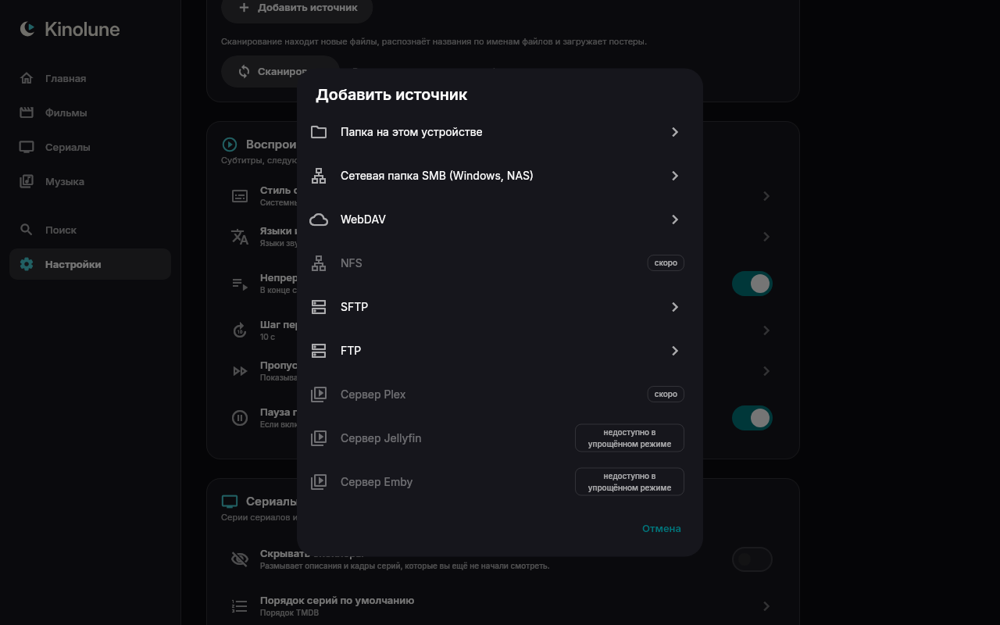

<!-- SPDX-License-Identifier: MPL-2.0 -->

# Sources: folders, NAS and media servers

A source is where your files live: a folder on the device, a shared folder on a computer or NAS, or a media server. Kinolune reads files straight from there; it copies nothing anywhere and deletes nothing.

One source can hold everything mixed together: movies, shows, anime, music, audiobooks, phone clips. Kinolune works out the type of each file by itself (see [Recognition](03-recognition.md)).

## Adding a source

1. Settings → Library & sources → **Add source** (or the "Add your first source" step of the setup assistant).
2. At the top, under "On this network", Kinolune lists the shared folders and servers it found. Pick one and the address is filled in. If the list is empty, choose a type under "Add manually".
3. Fill in the form and press "Add and scan". Kinolune checks the connection, scans the files and starts recognising titles. Progress is shown in the side menu, in Settings and on the Sources screen.

Supported: folder on this device, SMB (Windows, NAS), WebDAV, SFTP, FTP/FTPS, Jellyfin, Emby, Subsonic (Navidrome). NFS and Plex are marked "soon" and cannot be added yet.

### Common form fields

- **Display name (optional)** — how the source is labelled. Empty means a name from the address.
- **User name** and **Password** — for signing in. The password is kept in the system's secure storage (Keychain, Android Keystore, Windows Credential Manager, Secret Service on Linux). When you edit a source, an empty password field keeps the saved password.
- **Add files to the library** — turn off to only browse the source with "Browse files", without scanning.
- **Rescan automatically** — Kinolune notices new files by itself.
- **Sync to my devices** — the source appears on your paired devices (see [Devices](10-devices-and-tv.md)). The password is sent only with "Include the password"; it travels encrypted.
- **Advanced** — rare settings: domain, protocol version, encryption and signing for SMB; certificate fingerprint for WebDAV and FTP; keys for SFTP.

## Folder on this device

Press "Browse…" and pick a folder, or type the full path. On Android, Kinolune asks for access to video, audio and storage; without it the files cannot be read.

A network folder mounted by the system (a mapped drive on Windows, a mounted share on Linux) can also be added as an ordinary folder.

## SMB shared folder (Windows, NAS)

SMB is added with a three-step assistant.

1. **Where are the files?** Pick a computer or NAS under "Found on your network", or type the "Computer or NAS address". A name, an IP address or a whole folder address works: `\\nas\video\Movies` or `smb://nas/video/Movies` — Kinolune sorts it out. If you know the folder path, type it in "Folder path (if you know it)".
2. **Sign in.** Enter the user name and password for the share. If the share is open to everyone, turn on "No password (guest)". Press "Connect".
3. **Choose a folder.** Open the shared folder and, if needed, a folder inside it, then press **Use this folder**.

If you typed a path in step 1, Kinolune opens that folder for you.

### Hidden shares

Some servers do not show their list of shared folders (hidden shares ending in `$`, Samba settings, NAS policy). Step 3 then says "The server does not show its list of shared folders" and offers a **Shared folder name** field. Type the name exactly as it appears in `\\server\name` or in the NAS settings (for example `video` or `media$`) and press Open. You can also paste `\\server\name\folder` as a whole.

### If it does not work

- **The computer is not listed.** Type the address. On Windows, allow Kinolune on private networks in the firewall.
- **The server does not allow guests.** Turn off "No password" and sign in with a name and password.
- **Wrong password or no answer** — the reason appears in a red box; "Details" shows the technical text (the password is hidden).
- **No shared folders visible for this user.** Check the user's rights on the server or type the share name.
- If a source later reports "no shared folder" or "folder not found", press "Choose a folder" on the Sources screen and pick it again — no need to retype the password.

## WebDAV, SFTP, FTP

Type the "Server address" with its scheme:

- WebDAV — `https://server/path` (or `http://`);
- SFTP — `sftp://server/path`;
- FTP — `ftp://server/path`, or `ftps://server/path` for an encrypted connection.

Do not put the user name into the address; it has its own field.

**SFTP.** Instead of a password you can give a private key. The "Server key" field can stay empty: the server's key is remembered on the first connection, and if it changes later Kinolune refuses to connect and warns you. Old RSA keys are rejected by default; if your server only offers them, turn on Settings → Library & sources → RSA keys for SFTP.

**WebDAV and FTPS with a self-signed certificate.** Enter the certificate fingerprint under "Advanced", and Kinolune trusts only that certificate.

## Jellyfin and Emby

Kinolune shows the movies, shows and music of your Jellyfin or Emby server in its own library and marks what you watched on the server too.

1. Add source → **Jellyfin server** or **Emby server**.
2. "Server address" — the address you open the server with in a browser, for example `http://server:8096` (`http://` is added if you omit the scheme).
3. "Other addresses" — optional fallbacks, one per line, for example an outside address for watching away from home. If the main one does not answer, Kinolune tries these.
4. Sign in:
   - **Password** — your Jellyfin or Emby user name and password. Emby needs a local server user; Emby Connect is not supported.
   - **Quick Connect** (Jellyfin only) — press "Get a code" and enter the code in another Jellyfin app where you are signed in: Settings → Quick Connect. The source is added by itself. If Quick Connect is turned off on the server, sign in with the password.

Kinolune keeps only the server's access key, not your password. The address and name can be changed later with "Edit" without signing in again.

## Subsonic and Navidrome

For Subsonic, OpenSubsonic and Navidrome music servers. Enter the address, the user name and password, or turn on "Sign in with an API key". Kinolune checks the sign-in right away. The server's music appears in Music, and plays are reported back to the server (scrobbling).

## The Sources screen

Settings → Library & sources → **Manage sources**. Each source shows its state ("Online", "Unavailable"), the last scan and these buttons:

- **Browse files** — the source's folders and files. Recognised movies open their page; anything else plays right away. "Move to Personal" and "Not this" are here too (see [Recognition](03-recognition.md) and [Personal](05-personal-and-files.md)).
- **Rescan** — this source only.
- **Check connection** and **Speed test** — the test tells you whether the speed is enough for 4K.
- **Edit** and **Delete**. Deleting removes the source and its titles from the library; the files on the disk or server stay.

If only "Folder on this device" is available (simplified mode, without the Kinolune core), see [Troubleshooting](12-troubleshooting.md).
