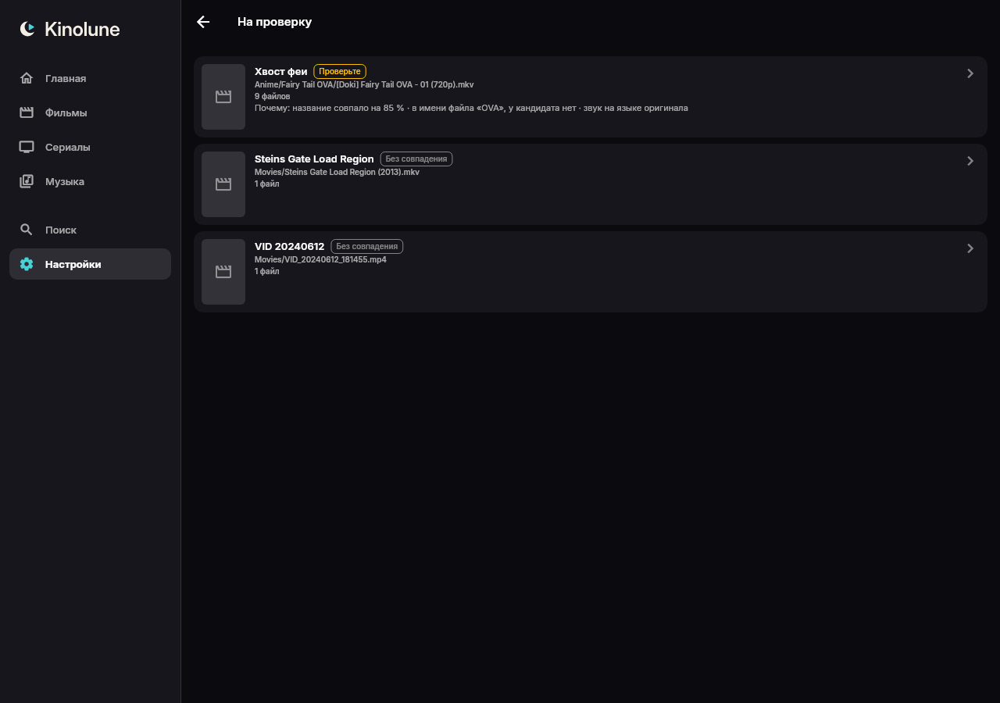
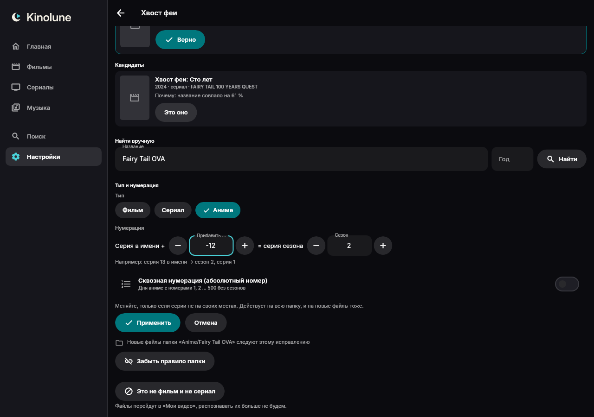

<!-- SPDX-License-Identifier: MPL-2.0 -->

# Recognition and how to fix it

After a scan, Kinolune decides by itself what each folder holds and finds the title, poster and description. You never choose a type up front.

| Found | Goes to |
|---|---|
| A movie | Movies |
| Episodes of a show or anime | TV Shows |
| Music | Music |
| Audiobooks (folders of chapters, m4b files) | Books |
| Phone and camera clips (`VID_20240612_181455.mp4` and the like) | My videos — no online lookups |

Movie and show titles come from TMDB, anime from the bundled anime database, AniList and Shikimori, music from MusicBrainz, audiobooks from Open Library.

## Naming files so everything is recognised at once

Kinolune handles real-world names with release tags, but the simpler the name, the better the result:

```text
Movies/
  The Quiet Orbit (2024)/
    The Quiet Orbit (2024).mkv
    The Quiet Orbit (2024)-trailer.mkv  ← your own trailer
    Extras/                             ← bonus material
Shows/
  Moonlit Bureau/
    Season 01/
      Moonlit Bureau S01E01.mkv
      Moonlit Bureau S01E02.mkv
Anime/
  Title/
    Title - 01.mkv                      ← absolute numbering works too
```

- **The year in brackets** tells apart movies with the same title.
- **Episodes** — `S01E02`, `1x02` or an episode number in the name; folders `Season 1`.
- **Extras** — folders `Extras`, `Featurettes`, `Behind The Scenes`, `Deleted Scenes`, `Interviews`, `Trailers`, or suffixes `-trailer`, `-featurette`, `-interview` on a file next to the movie. They show on the movie page and do not become separate movies.
- **NFO.** If a `movie.nfo` or `<video name>.nfo` (for a show, `tvshow.nfo` in the show folder) next to the video holds a TMDB, IMDb, TVDB or AniDB ID, Kinolune uses exactly that ID and does not guess by title. NFOs from Kodi, Jellyfin and Emby work, as do `imdb.com/title/tt…` or `themoviedb.org/movie/…` links in release NFOs.
- **Discs.** `BDMV` and `VIDEO_TS` folders and ISO images are recognised as one movie. ISO images do not play yet; the app explains this when you try.
- **Movie parts** (`CD1`, `CD2`, `part1`) are joined into one movie; several files of one movie become "versions".

## To review: when Kinolune is not sure

A confident match simply appears in the library. When Kinolune has doubts, it shows its best guess marked "check" and adds it to the **To review** list. If nothing similar was found, the item lands there marked "No match".



Where to find it:

- on Home — the "Check recognition: N" button;
- Settings → Library & sources → To review;
- on a movie or show page — the bar "This may be the wrong title: pick the right one or confirm";
- on a poster in the library — the "?" badge.

Each row says why Kinolune has doubts ("Why: the title matched 85 % · …"). Open the row:

- **Correct** — keep it;
- **This one** on a candidate — pick it; poster and description update;
- **Why?** on a candidate — what speaks for and against it (title, year, episodes, runtime), next to "N% sure";
- **Paste an ID or link** — paste a page link from themoviedb.org, thetvdb.com, imdb.com, anidb.net, myanimelist.net, shikimori.one or anilist.co (or an ID like "tvdb 81189") and press Find; the clipboard button pastes and looks it up at once;
- **Find manually** — type a title (and year) and pick a result; anime is also searched in the anime database on the device, offline;
- **This is not a movie or series** — the files move to My videos and are no longer recognised.

A choice applies to **every file** of the work and to new files of its folder — for example all 24 episodes of a season. Picking a series for what the app took for a movie switches the type by itself. Afterwards the app says how many files were fixed.

On the page itself it is quicker: tap a candidate's poster right in the bar, "Correct", or "Something else…" for the full page.

## Fixing something already recognised

If a movie or show is wrong, open the poster menu (right click, long press or the remote's menu key — in the library and on Home) and choose **Fix match**, or use that button on its page. The same page as in To review opens.

### Type and numbering

That page has a "Type and numbering" section. Everything here applies to **the whole folder**, including files added to it later.



- **Type: Movie, TV Show or Anime** — if the folder got the wrong type.
- **Numbering** — if episodes are in the wrong places. Press "Change numbering" and set the phrase "Episode in the name + [N] = episode of season [S]". The example below the fields shows the result at once: with an offset of −12 and season 2, "episode 13 in the name → season 2, episode 1". For anime numbered 1…500 without seasons, turn on "Running count (absolute number)". Press "Apply".

### Folder rule

Kinolune remembers every fix as a **folder rule**: new files in that folder are recognised the same way. The page shows this as "New files of the folder … follow this fix". "Forget the folder rule" removes it, and new files are recognised from scratch again.

## "Not this" in the file browser

If a whole folder has the wrong type (say, music videos ended up in Movies), open the source with "Browse files" and press **Not this** on the folder. The type changes at once; "Undo" in the message reverts it.

## Episode order

Some shows and anime have several episode orders. On the show page, the "TMDB order" button lets you choose "TMDB order", "Absolute order" or "AniDB order". The choice is remembered for the show. The default for all shows is in Settings → TV Shows → Default episode order.

## Metadata settings

Settings → Metadata:

- **Metadata language** — "Same as the interface", Russian or English. Titles and descriptions update after the next scan.
- **TMDB API key** — GitHub builds already include a key. You need your own only if you built the app yourself or want your own quota.
- **Update the anime database** — check GitHub once a day for a new anime database (on). "Anime database" shows the version and a "Check now" button.
- **Recognise anime by its frames** — **off by default**. When on, up to 10 frames of an anime episode that was not recognised by name are sent to trace.moe. No file name or other data is sent.

Recognition progress is shown in Settings → Library & sources: "Recognition in progress", "Waiting for recognition: N" or "Everything is recognised". If a service asks to wait (rate limit), Kinolune says so and carries on by itself.
