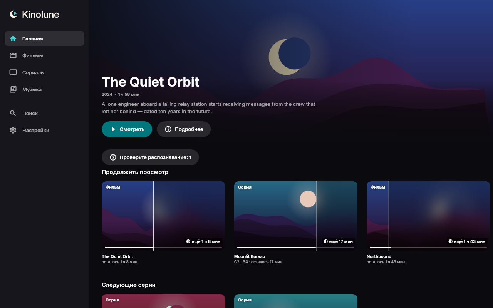

<!-- SPDX-License-Identifier: MPL-2.0 -->

# Library, search and downloads

## Sections

A wide window has a side menu, a narrow one a slim rail, a phone has tabs at the bottom, and a TV has a menu at the top. The sections:

- **Home** — what you are watching and what is new.
- **Movies** and **TV Shows** (on a phone, the "Library" tab with a switch).
- **Streams** — Twitch; appears once turned on in Settings ([more](08-twitch.md)).
- **Music** and **Books** — Books shows only when the library has audiobooks ([more](07-music-and-audiobooks.md)).
- **Personal** — [personal libraries](05-personal-and-files.md).
- **Search** and **Settings**. On a phone, Settings opens from the profile avatar at the top right of Home.

Tapping the open section again takes you back to its start.

## Home

- The banner at the top: "Play" and "More info" (for a show, "Episodes"). Hovering or focusing a card in a row switches the banner to it.
- **Continue Watching** — started movies, episodes and Twitch videos with a progress bar and time left. Tap to resume.
- **Up Next** — the next episode after the one you finished.
- **Favorites**, **Recently Added Movies**, **Recently Added TV Shows**, pinned smart shelves, genre rows.
- **My videos**, **Music**, **Sources** (a source card opens its files).
- If another of your devices is playing something right now, the top shows "Playing on …" with "Continue on this device".

When a scan finds new movies or episodes, a notice with an "Open" button appears.

## Movies and TV Shows

- **Grid** or **List** — remembered separately for movies and shows.
- **Sort by**: title, recently added, year, recently watched, duration, my rating. Picking the same field again flips the direction.
- **Filters**: Unwatched, In progress, Watched, decade, resolution (SD…4K), HDR (HDR10, HDR10+, Dolby Vision, HLG), genre. Filters in one group mean "or", across groups "and". "Clear filters" removes them all.
- **Letters on the right** — jump through the alphabet when sorted by title.

Poster badges: "✓" watched, "◐" and a bar in progress, a number — episodes left in a show, "New" — added in the last 14 days, "?" — recognition worth checking.

### Poster menu

Right-click, long-press, the Menu key (or Shift+F10), or a long press of OK on a remote:

- Play — from where you stopped; for a show, the started or first unwatched episode;
- Mark as watched / Mark as unwatched (for Jellyfin and Emby, on the server too);
- Add to favorites / Remove from favorites;
- Add to playlist — an existing or a new playlist;
- Edit metadata — see [Recognition](03-recognition.md);
- Download — an offline copy (network sources only, see below);
- Move to personal media — see [Personal](05-personal-and-files.md).

You cannot delete a movie from the library: Kinolune does not touch your files. Remove the file from the source, or delete the source.

## Movie and show pages

- **Play** / **Resume from 12:34** and **From beginning**. A line "Stopped at … · 2 days ago" also says on which device you stopped.
- If a movie has several files (for example 1080p and 4K), Kinolune asks which version to play. The pin "Play this version by default" remembers it.
- **Add to favorites**, **Trailer**, **Fix match**.
- Cast & Crew, Extras, the collection row (other movies of the collection), Technical info (container, codecs, tracks).
- For a show: seasons (Specials last), the episode list with watched marks, "Download season", the episode order choice.

**Hide spoilers** (Settings → TV Shows) blurs descriptions and frames of episodes you have not started.

## Search

Start typing a title, year, artist or album — results appear at once, grouped into Movies, TV Shows, Episodes and Music. Recent searches are kept on the device, per profile; remove them one by one, with "Clear history", or in Settings → Privacy.

On a TV you can type on a paired phone ([more](10-devices-and-tv.md#typing-from-your-phone)). On Android TV, voice search works: "find … in Kinolune".

## Playlists

"Add to playlist" in the poster menu: pick a playlist or create a new one. A show is added with all its episodes. Music playlists are described in [Music](07-music-and-audiobooks.md).

## Downloads for offline viewing

Movies, episodes and music from **network** sources (SMB, WebDAV, SFTP, FTP, Jellyfin, Emby, Subsonic) can be downloaded to the device, for example before a trip.

1. On a movie or episode page press "Download" (for a show "Download season", for an album "Download album"). If a movie has several versions, pick which one.
2. Progress shows on the button ("Downloading 45 %", "Downloaded") and in Settings → Downloads → Downloads, which also has Pause, Resume, Cancel and Try again.
3. Offline, a downloaded movie opens and plays from the copy.

Download settings: "Download folder" (can be changed on a computer), "Wi-Fi only", "Delete watched" (at once, after 1, 7 or 30 days, or never). On Android a download keeps going with the app closed, with progress and buttons in a notification. Battery saver pauses downloads.

"Delete download" deletes only the copy on the device — the movie stays in the library and plays from the source.
