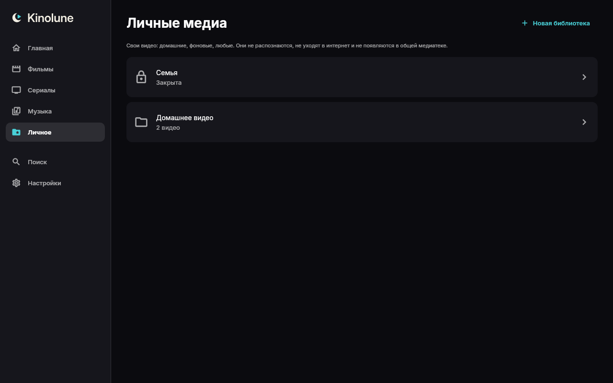
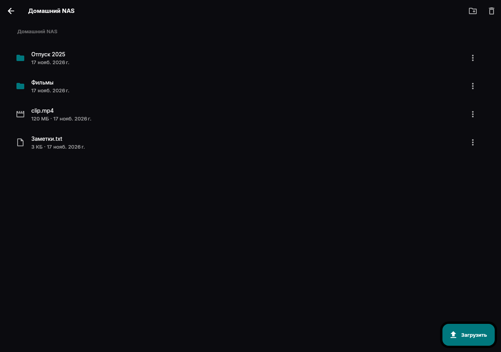

<!-- SPDX-License-Identifier: MPL-2.0 -->

# Personal, My videos and files

## My videos

Kinolune spots clips from phones and cameras by itself and shows them separately: the **My videos** row on Home and the My videos page ("See all" at the end of the row). No titles are looked up online for them, and their progress does not go into Continue Watching.

My videos are visible to every profile. To hide a folder of clips, open a clip's menu (long-press, right-click, the Menu key or a long OK on the remote) → **Hide the folder in Personal** and choose a personal library.

## Personal

Personal holds private libraries for home videos and anything else. What is in them:

- is not recognised and never goes online;
- does not appear in the shared library, search or Continue Watching;
- keeps its resume point inside that library only, and it is not sent to your other devices;
- can be locked with a PIN or a password.

### Create a library

1. Personal → **New library**.
2. Type a name and choose the "Lock": "None", "PIN code" (default) or "Password" (at least 6 characters).
3. "Save". The library opens right away.

### Add videos

- **Add folder** (the library's ⋮ menu) — choose a source and a folder, then "Choose this folder". The videos stay where they are; the library only shows them.
- **Move to Personal** in a source's file browser — for a folder or the whole source. "Back to the library" undoes it.
- **Move to personal media** in a movie's poster menu — the movie leaves the library for the chosen personal library. "Back to the library" in the video menu brings it back.
- **Upload** — upload files from this device (see below).
- **Share → Kinolune** from the gallery or another Android app — the files are uploaded to the first unlocked personal library.

### Inside a library

- A Continue row with the started videos of this library.
- Search by title, filters by category, tag and rating, "Sort by".
- The video menu (⋮ or long-press): Play, Rating (1–5 stars), Tags, Categories, remove from Continue, Back to the library.
- The library menu: Add folder, Rename, Change the lock, Delete library. Deleting leaves the files where they are.
- "Close" locks a library with a lock again.

### Privacy

- When the app goes to the background, all libraries lock and the screen is covered, so the recent-apps view shows no preview.
- On Android, while a personal library is open, the system blocks screenshots and screen recording.
- Too many wrong PINs or passwords in a row block input for a while.

## Files

Sources you can write to (folder on this device, SMB, WebDAV, SFTP, FTP) have a file view, like Nextcloud. Open it with **Files** in a source's file browser or in a personal library.

- **Upload** — on a computer the file picker opens straight away; on a phone or TV choose "From the gallery" or "From files". Several files at once are fine. Uploads run in the background with a queue at the bottom; an interrupted upload resumes where it stopped.
- **New folder**.
- The file's ⋮ menu: Rename, Move to…, Copy to…, Delete. On a computer you can drag a file onto a folder or onto a part of the path at the top.
- If a name is taken, Kinolune asks once for all files: "Keep both" (default), "Replace" or "Skip".

### Trash

Delete does not erase a file; it puts it into the source's **trash**. The "… in the trash" message has an "Undo" button. The trash (icon at the top right) keeps deleted items for 30 days, where you can "Restore" them or "Delete forever". "Clear" erases everything in the trash and cannot be undone.

### Personal storage

Where uploads to Personal go is set in Settings → Personal storage: "Automatic" (the first source you can write to, otherwise a folder on this device), a specific source, or "On this device". If there is nowhere to write, Kinolune asks you to add a writable source.
