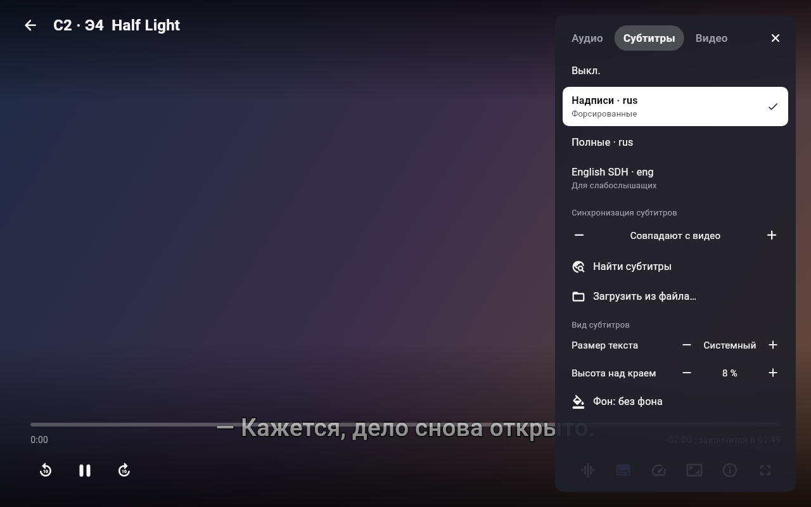
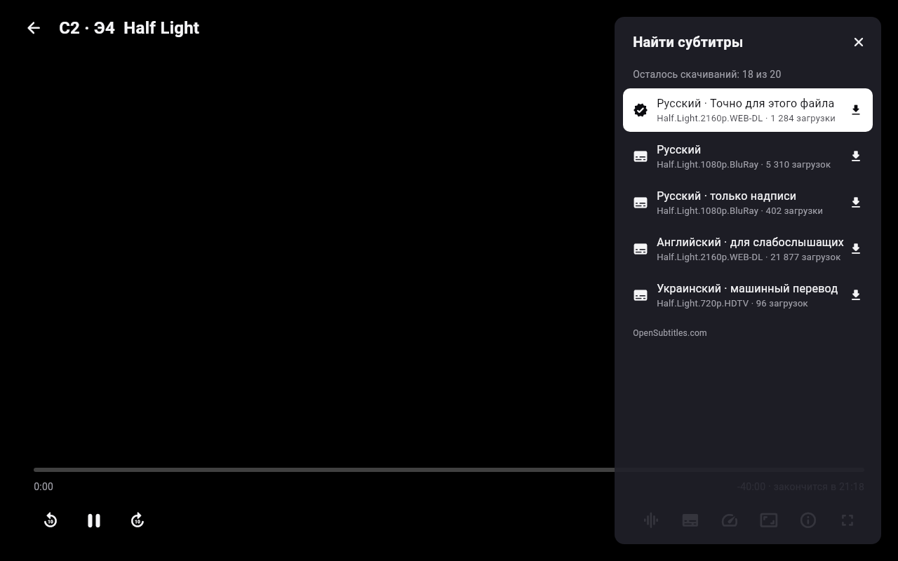

<!-- SPDX-License-Identifier: MPL-2.0 -->

# Watching: tracks, subtitles, trailers

"Play" opens the player and resumes where you stopped. The position is saved every few seconds, on pause and on exit, so at most 10 seconds are lost.

## Controls

Tap the video or move the mouse to show the controls; during playback they hide by themselves after 4 seconds.

| Action | Mouse and touch | Keyboard and remote |
|---|---|---|
| Pause / resume | centre button at the bottom | Space, OK, Play/Pause |
| Skip one step | ±10 s buttons, double-tap left or right | ← / → |
| Jump anywhere | tap or drag the bar (a preview frame appears above it) | — |
| Previous / next chapter | Chapters panel | PageUp / PageDown, previous / next media keys |
| Volume / brightness (phone) | swipe up or down on the right / left | M — mute |
| Zoom | pinch | Z — zoom mode |
| Speed | Speed panel | [ and ] |
| 2× while held | long-press the video | — |
| Full screen (computer) | double-click the centre | F |
| Info, statistics | Info button | I, S |
| Exit | arrow at the top left | Esc, Back |

The skip step (5, 10, 30 s…) is set in Settings → Playback → Skip interval.

On Android the video moves to a picture-in-picture window when you press Home. Controls are on the lock screen and in the notification; headset buttons work.

## Audio, subtitles and video

The buttons at the bottom right open a panel with **Audio · Subtitles · Video** tabs. On a computer it is on the right, on a phone it slides up from the bottom, on a TV it is at the top.

- **Audio** — choose a track (marked "Commentary", "Audio description"), "Audio delay" in 50 ms steps, downmix to stereo, "Subwoofer (LFE) in stereo", "Normalize downmix", "Volume Boost".
- **Subtitles** — Off or a track (marked "Forced", "Hard of hearing"), subtitle sync in 100 ms steps, "Find subtitles", "Load from file…", subtitle look (size, height above the edge, background).
- **Video** — the video stream if there are several, and zoom modes: Fit, Fill, Stretch, aspect ratios.

The audio, subtitles and delays you choose are **remembered for the show**: the next episode starts with them.

### Which tracks are picked automatically

Settings → Playback → Languages and sound:

- "Audio language": "Auto (interface language, else original)", "Original" or "Chosen languages" (in order of preference).
- "Subtitle language" and "Show subtitles": "Auto: for speech in other languages", "Always", "Forced only", "Off".
- "Subtitles for the deaf and hard of hearing (SDH)": "System default", "Prefer", "Avoid".
- Downmix, normalisation, LFE and boost — the same as in the panel.

### External subtitles

`.srt`, `.ass` and other subtitle files next to the video (or in a `Subs` folder) are picked up automatically. Use "Load from file…" for any other file.

### Subtitle style

Settings → Playback → Subtitle style. "System caption style" is on by default and follows the device settings. Turn it off to choose size, font, colour, background and position. "Override ASS styles" shows styled subtitles (anime, karaoke) as plain text in your style. "Brightness over HDR video" keeps white subtitles from being blinding in HDR.

## Finding subtitles online

If no suitable subtitles exist, press **Find subtitles** in the Subtitles tab. Kinolune searches two places at once: OpenSubtitles.com by the file's fingerprint and the movie ID, and SubDL.com by the movie or show ID. Results from both come in one list; the second line of each says where it is from. Results exact for this file come first, then your profile's languages and the most downloaded. Tap one and it is downloaded and turned on (a SubDL archive is unpacked for you; for an episode in a whole-season archive, the file of that episode is taken). If one source does not answer, the other's results are still shown.

OpenSubtitles limits downloads per day; what is left is shown above the list. Without signing in, the limit is counted per network address. For your own quota, sign in: Settings → Playback → Subtitle style → Subtitles from the internet, "OpenSubtitles login", password, "Save and check". Search works for movies and episodes of the library; it is not offered for music or personal videos. In a build without a SubDL key, the same settings take your own free key ("SubDL API key"); without one only OpenSubtitles is searched.

## Skipping intros and the next episode

Kinolune finds intros, recaps and credits by comparing the episodes of a season (or from "Opening" and "Credits" chapters), and also imports ready-made Plex and Jellyfin markers. Settings → Playback → Skip intro and credits:

- "Show a button" — "Skip intro", "Skip recap", "Skip credits" at the bottom right;
- "Skip after 3 seconds" or "Skip at once";
- "Off".

At the end of an episode an "Up next" card counts down: "Play now" or "Cancel". With "Continuous playback" off, the card stays but without a countdown.

## Trailers

**Trailer** on a movie or show page plays its trailer. Kinolune looks in this order:

1. Your own trailer file next to the movie (`-trailer`, a `Trailers` folder).
2. A trailer from your media server (Jellyfin, Emby).
3. A YouTube or Vimeo trailer from TMDB, in the site's official embedded player, never downloaded. Where there is no embedded player (Windows, Linux), the trailer opens in your browser.

Your own trailer starts playing muted in the page header after about a second and a half. Settings → Trailers:

- "Play in the banner": "Always", "Wi-Fi only", "Never";
- "Trailers from the internet" — turn off to avoid YouTube and Vimeo; only your own and server trailers remain.

With the system "Remove animations" setting or Android battery saver, the header trailer does not start by itself.

## If a file does not play

ISO disc images and some rare formats do not play yet; Kinolune shows "This file can't be played" with the reason. For everything else see [Troubleshooting](12-troubleshooting.md).
