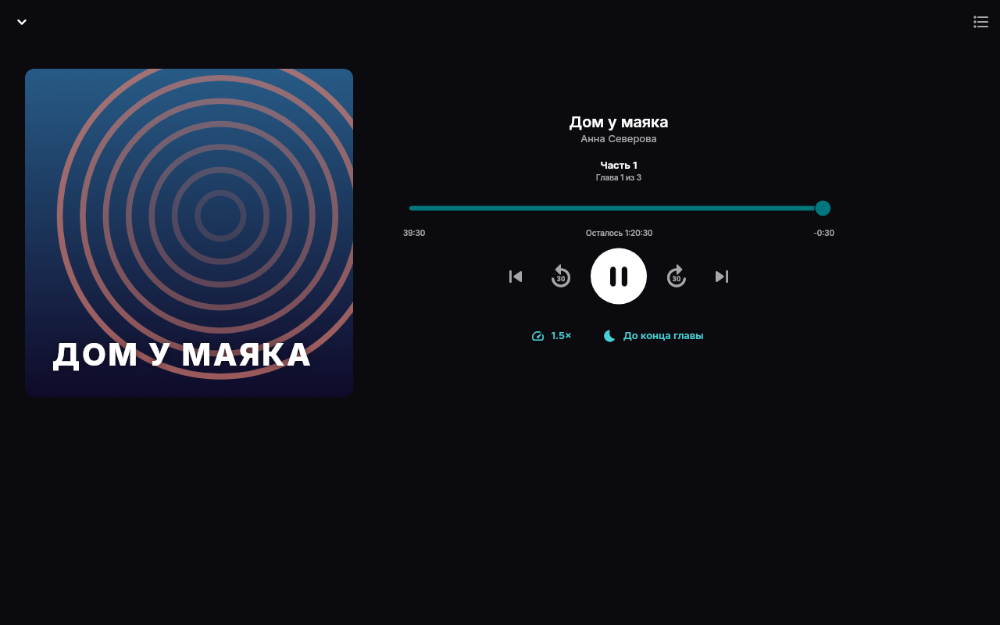

<!-- SPDX-License-Identifier: MPL-2.0 -->

# Music and audiobooks

## Music

Music from your sources appears in Music by itself. Albums, artists and covers come from the file tags; what is missing (genres, label, artist details, covers) comes from MusicBrainz and the Cover Art Archive.

- **Home** — Recently played, Frequently played, Mixes ("From your favorites", "Mix: <genre>"), Recently added albums, Artists.
- **Library** — Playlists, Artists, Albums, Tracks, Genres, Composers, Folders. The Downloaded, Hi-Res and Lossless chips filter the list.
- **Shuffle all** — all your music in random order.

Tapping a track plays the whole list from that track. The track menu (long-press, right-click, Shift+F10): Play next, Add to queue, Add to playlist.

### Playlists

- **New playlist** — an empty playlist; add tracks from the track menu.
- **Import M3U** and **Export M3U** — exchange playlists with other players.
- **New smart playlist** — a playlist built from rules: genre, year, play count, format (for example "Genre contains jazz" and "Format is Lossless"). Choose "All rules" or "Any rule", a sort order and a track limit. New tracks join it by themselves.
- Download playlist and Download album — offline copies for network sources.

### Now Playing

The mini-player sits at the bottom; tap it for Now Playing: cover, seek bar, shuffle, repeat (all / one), and the **Queue** and **History** tabs. Queue items can be dragged, swiped away or removed with the cross; "Save as playlist" keeps the queue.

The queue, position and modes survive a restart; each profile has its own queue. Playing a video pauses the music; after the player you can press "Resume".

On Android music plays in the background with a notification and lock-screen controls, and keeps going even if you swipe the app away from Recents.

Settings → Music: "Gapless playback" and "Volume levelling (ReplayGain)" — per track, per album or automatic.

## Audiobooks

The **Books** section appears by itself once the library has audiobooks:

- a folder with the parts of a book (subfolders such as `CD1` or `Part 1` belong to the same book);
- a file with chapters (`.m4b`).

Folders like `Author - Title (Narrator)` and series like `Series/02 - Title` are recognised best. Kinolune looks for a description and cover on Open Library when the folder has no cover of its own. If the book is not matched confidently, its page says Kinolune is not sure which book it is, and no online data is filled in.

- **Continue listening** — started books with the time left.
- The book page: author, narrator, series, chapters. "Play", "Resume from 40:00" or "Listen again".
- The book player: chapter jumps, "Back 30 seconds" and "Forward 30 seconds", **Speed** (0.5×–3×, remembered), **Sleep timer** (5–60 minutes or "End of chapter"), and the chapter list.

Your place in a book is saved automatically. A book and music never play at the same time, and audiobooks do not show up in Music.
