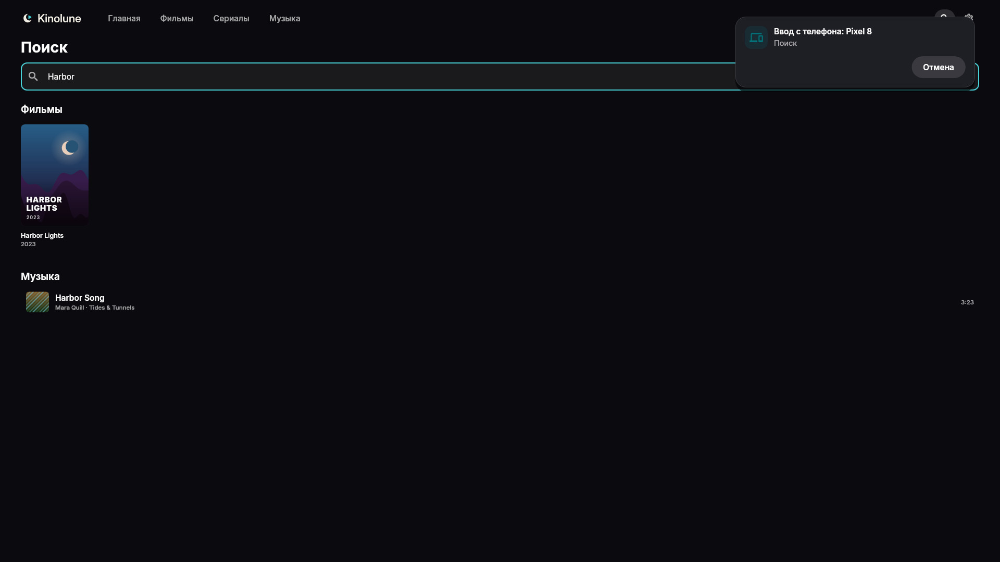

<!-- SPDX-License-Identifier: MPL-2.0 -->

# Devices: sync, TV and remote

## Syncing between devices

Kinolune on your phone, computer and TV can be paired. Paired devices exchange, **over your home network** and without any cloud:

- resume points, Continue Watching and watched marks;
- categories, tags and ratings;
- profiles;
- network sources with "Sync to my devices" turned on (the password only with "Include the password").

Files are not copied: each device reads them from the source.

### Pair two devices

Both devices must be on the same network.

1. On the first device: Settings → Devices → **Show code**. A QR code and a 6-digit code appear (valid for a few minutes).
2. On the second device: Settings → Devices → type the code into "6-digit code" and press "Connect". On a phone or tablet you can press "Scan QR code" and point the camera at it.
3. Both devices show that they are paired.

The last step of the setup assistant ("Pair a device") does the same.

"Paired devices" shows which ones are online. "Unpair" removes another device; "Leave" turns sync off on this device (your progress on it stays).

### Continue on another device

- If another device is playing something right now, Home shows "Playing on …" → **Continue on this device**.
- If another device got further while you are watching, Kinolune offers to jump to that time.
- If the same video starts on another device, it pauses here. To turn this off: Settings → Playback → "Pause when another device takes over".

## Using a remote (Android TV, Google TV)

- Top menu: ← / → switch sections, ↓ moves to the content.
- OK opens or presses, Back goes one step back; from a section's start to the menu, from Home — exit.
- **Long-press OK** (or the Menu key) on a card — the card menu: Play, Add to favorites, Edit metadata and more.
- On a movie page the focus starts on Play; "up" from the top row of buttons plays the trailer full screen.
- In the player: OK pauses, ← / → skip, ↓ goes to the buttons, Info shows file details.
- On-screen notices never take the focus: ↑ from the top edge of a page moves to their buttons.

### Typing from your phone

Typing a title with a remote is slow. If a phone with Kinolune is paired with the TV, rest the focus on a search, address or password field — the phone opens an input sheet by itself (or shows a "Type from your phone" notification). Text appears on the TV as you type, and "Done" on the phone runs the search. A password travels encrypted and is not kept on the phone.

Without a paired phone, OK on a field opens the TV's on-screen keyboard.

### Android TV integration

- Started movies and next episodes appear in the launcher's system "Continue watching" / "Play Next" row. Selecting a card resumes playback. A card you remove there comes back only after you watch that title again.
- Switching profiles switches the row to the new profile's Continue Watching.
- Voice search "find … in Kinolune" opens Search with results.

## Computer: keyboard and mouse

- Tab / Shift+Tab and the arrow keys reach every element, Enter or Space presses, Esc goes back.
- Right-click or Shift+F10 — the item menu.
- F6 — to the buttons of an on-screen notice.
- Kinolune runs as a single copy: starting it again brings the open window to the front.
- "Open With → Kinolune" on a video or audio file plays it.
- On macOS there is a menu bar: File → Sources… ⌘O, File → Search ⌘F, sections ⌘1…⌘7 in the View menu, Playback → Play/Pause ⌘P and more.

### kinolune:// links

Links open Kinolune from a browser, a shortcut or a script:

| Link | Opens |
|---|---|
| `kinolune://search?q=text` | Search with that query |
| `kinolune://item/<id>` | A movie or show page |
| `kinolune://play/<id>` | Playback from the saved position |
| `kinolune://channel/<login>` | A Twitch channel (if Streams is on) |

With App Lock on, the PIN screen comes first.
