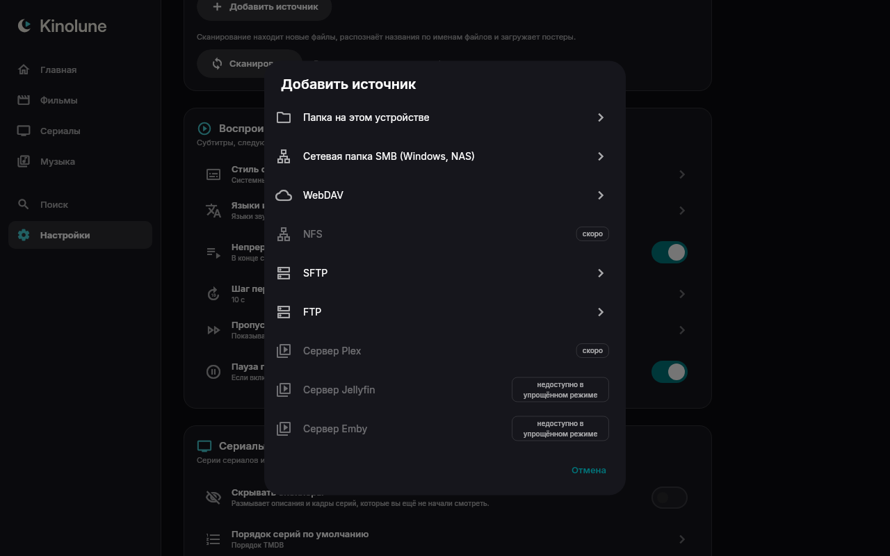

<!-- SPDX-License-Identifier: MPL-2.0 -->

# Источники: папки, NAS и медиасерверы

Источник — место, где лежат ваши файлы: папка на устройстве, сетевая папка на компьютере или NAS, медиасервер. Kinolune читает файлы прямо оттуда, ничего никуда не копирует и ничего не удаляет.

Один источник может хранить всё вперемешку: фильмы, сериалы, аниме, музыку, аудиокниги, ролики с телефона. Тип каждого файла Kinolune определяет сам (подробнее — в [«Распознавание»](03-recognition.md)).

## Как добавить источник

1. «Настройки → Медиатека и источники → Добавить источник» (или шаг «Добавьте первый источник» в мастере первого запуска).
2. Вверху, в разделе «В этой сети», Kinolune показывает найденные сетевые папки и серверы. Нажмите на нужный — адрес подставится сам. Если там пусто, выберите тип в списке «Добавить вручную».
3. Заполните форму и нажмите «Добавить и сканировать». Kinolune проверит связь, просканирует файлы и начнёт распознавать названия. Ход работы виден в боковом меню, в Настройках и на экране «Источники».

Поддерживаются: папка на устройстве, SMB (Windows, NAS), WebDAV, SFTP, FTP/FTPS, Jellyfin, Emby, Subsonic (Navidrome), серверы DLNA/UPnP и плейлисты M3U. NFS и Plex помечены «скоро» — их пока добавить нельзя.

### Общие поля форм

- **«Отображаемое имя (необязательно)»** — как источник подписан в приложении. Пусто — имя возьмётся из адреса.
- **«Имя пользователя» и «Пароль»** — для входа. Пароль хранится в защищённом хранилище системы (Keychain, Android Keystore, диспетчер учётных данных Windows, Secret Service в Linux). При изменении источника пустое поле пароля оставляет сохранённый пароль.
- **«Добавлять файлы в медиатеку»** — выключите, если хотите только просматривать файлы источника через «Обзор файлов», без сканирования.
- **«Пересканировать автоматически»** — Kinolune сам заметит новые файлы.
- **«Синхронизировать с моими устройствами»** — источник появится на ваших сопряжённых устройствах (см. [«Устройства»](10-devices-and-tv.md)). Пароль передаётся, только если включить «Передавать пароль»; он уходит зашифрованным.
- **«Дополнительно»** — редкие настройки: для SMB — домен, версия протокола, шифрование, подпись пакетов; для WebDAV и FTP — отпечаток сертификата; для SFTP — ключи.

## Папка на этом устройстве

Нажмите «Обзор…» и выберите папку. Можно ввести полный путь вручную. На Android Kinolune попросит разрешение на доступ к видео, аудио и хранилищу — без него файлы не прочитать.

Сетевую папку, подключённую в системе (например, диск в Windows или папку, смонтированную в Linux), тоже можно добавить как обычную папку.

## Сетевая папка SMB (Windows, NAS)

SMB добавляется мастером из трёх шагов.

1. **«Где лежат файлы?»** Выберите компьютер или NAS в списке «Найдены в вашей сети» или введите «Адрес компьютера или NAS». Подходит имя, IP-адрес и адрес папки целиком: `\\nas\video\Фильмы` или `smb://nas/video/Фильмы` — Kinolune разберётся сам. Если знаете путь к папке, впишите его в «Путь к папке (если знаете)».
2. **«Вход на …».** Введите имя пользователя и пароль от общей папки. Если папка открыта всем, включите «Без пароля (гость)». Нажмите «Подключиться».
3. **«Выберите папку».** Откройте общую папку и, если нужно, папку внутри неё, затем нажмите **«Использовать эту папку»**.

Если вы вписали путь на шаге 1, Kinolune сам откроет нужную папку и покажет «Нашли: общая папка «…»».

### Скрытые общие папки

Некоторые серверы не показывают список общих папок (скрытые папки с `$` в конце имени, настройки Samba, политика NAS). Тогда на шаге 3 появится сообщение «Сервер не показывает список общих папок» и поле **«Имя общей папки»**. Введите имя так же, как оно записано в адресе `\\сервер\имя` или в настройках NAS (например, `video` или `media$`), и нажмите «Открыть». Можно вставить и `\\сервер\имя\папка` целиком.

### Если не получается

- **Компьютер не находится в списке.** Введите адрес вручную. На Windows разрешите Kinolune доступ к частным сетям в брандмауэре.
- **«Сервер не пускает гостей».** Выключите «Без пароля» и войдите с именем и паролем.
- **Неверный пароль или сервер не отвечает** — сообщение появится в красной плашке; «Подробнее» показывает технический текст (пароль в нём скрыт).
- **«Этому пользователю не видно ни одной общей папки».** Проверьте права пользователя на сервере или введите имя общей папки вручную.
- Если у источника позже появилась ошибка «нет общей папки» или «папка не найдена», на экране «Источники» нажмите «Выбрать папку» и укажите её заново — пароль вводить не придётся.

## WebDAV, SFTP, FTP

Введите «Адрес сервера» со схемой:

- WebDAV — `https://сервер/путь` (или `http://`);
- SFTP — `sftp://сервер/путь`;
- FTP — `ftp://сервер/путь` или `ftps://сервер/путь` для шифрованного соединения.

Не пишите логин внутри адреса — для него есть отдельное поле.

**SFTP.** Вместо пароля можно указать «Закрытый ключ». Поле «Ключ сервера» можно оставить пустым: при первом подключении ключ сервера запомнится, а если позже он изменится, Kinolune откажется подключаться и предупредит. Старые RSA-ключи по умолчанию не принимаются; если ваш сервер умеет только их, включите «Настройки → Медиатека и источники → RSA-ключи для SFTP».

**WebDAV и FTPS с самоподписанным сертификатом.** Укажите «Отпечаток сертификата» в разделе «Дополнительно» — тогда Kinolune будет доверять только этому сертификату.

## Jellyfin и Emby

Kinolune показывает фильмы, сериалы и музыку с вашего сервера Jellyfin или Emby в своей медиатеке и отмечает просмотр на сервере.

1. «Добавить источник» → «Сервер Jellyfin» или «Сервер Emby».
2. «Адрес сервера» — адрес, по которому сервер открывается в браузере, например `http://сервер:8096` (если схему не указать, добавится `http://`).
3. «Другие адреса» — необязательно: запасные адреса, по одному в строке, например внешний адрес для просмотра вне дома. Если основной не отвечает, Kinolune пробует их.
4. Войдите:
   - **Пароль** — имя пользователя и пароль Jellyfin или Emby. В Emby нужен локальный пользователь сервера; вход через Emby Connect не поддерживается.
   - **Quick Connect** (только Jellyfin) — нажмите «Получить код» и введите показанный код в другом приложении Jellyfin, где вы уже вошли: «Настройки → Quick Connect». Источник добавится сам. Если Quick Connect выключен на сервере, войдите по паролю.

Kinolune хранит только ключ доступа сервера, а не ваш пароль. Адрес и имя можно поменять позже кнопкой «Изменить» без повторного входа.

## Subsonic и Navidrome

Для музыкальных серверов Subsonic, OpenSubsonic и Navidrome. Введите адрес, имя и пароль или включите «Войти по API-ключу». Kinolune проверит вход сразу при добавлении. Музыка сервера появится в разделе «Музыка», прослушивания передаются на сервер (скробблинг).

## Серверы DLNA / UPnP

DLNA-серверы (minidlna, NAS, «Медиа-сервер» Windows) находятся сами: пока открыто окно «Добавить источник», они появляются в «В этой сети». Нажмите на сервер и «Добавить и сканировать» — входить не нужно. Вручную укажите адрес описания устройства, например `http://192.168.1.10:8200/rootDesc.xml`. Kinolune берёт с сервера папки с файлами («Browse Folders»), поэтому каждый файл попадает в медиатеку один раз.

## Плейлист M3U

Плейлист `.m3u` или `.m3u8` со ссылками на видео и музыку: укажите ссылку на него или выберите файл. Файлы по ссылкам появятся в медиатеке под названиями из плейлиста, группы станут папками. Прямые эфиры (IPTV) пока не показываются. Ссылки плейлиста из интернета не открываются, если ведут в вашу домашнюю сеть или на само устройство.

Файлы `.strm` (одна ссылка на видео, как в Kodi и Jellyfin) в любом источнике тоже попадают в медиатеку и играют свою ссылку.

## Экран «Источники»

«Настройки → Медиатека и источники → Управление источниками». Для каждого источника видно состояние («В сети», «Недоступен»), время последнего сканирования и кнопки:

- **«Обзор файлов»** — папки и файлы источника. Распознанные фильмы открываются карточкой, остальное — сразу в плеере. Здесь же «Перенести в Личное» и «Это не то» (см. [«Распознавание»](03-recognition.md) и [«Личное»](05-personal-and-files.md)).
- **«Пересканировать»** — только этот источник.
- **«Проверить связь»** и **«Тест скорости»** — тест покажет, хватит ли скорости для 4K.
- **«Изменить»** и **«Удалить»**. Удаление убирает источник и его материалы из медиатеки; сами файлы на диске или сервере остаются.

Если в упрощённом режиме (без ядра Kinolune) доступна только «Папка на этом устройстве», см. [«Если что-то не работает»](12-troubleshooting.md).
