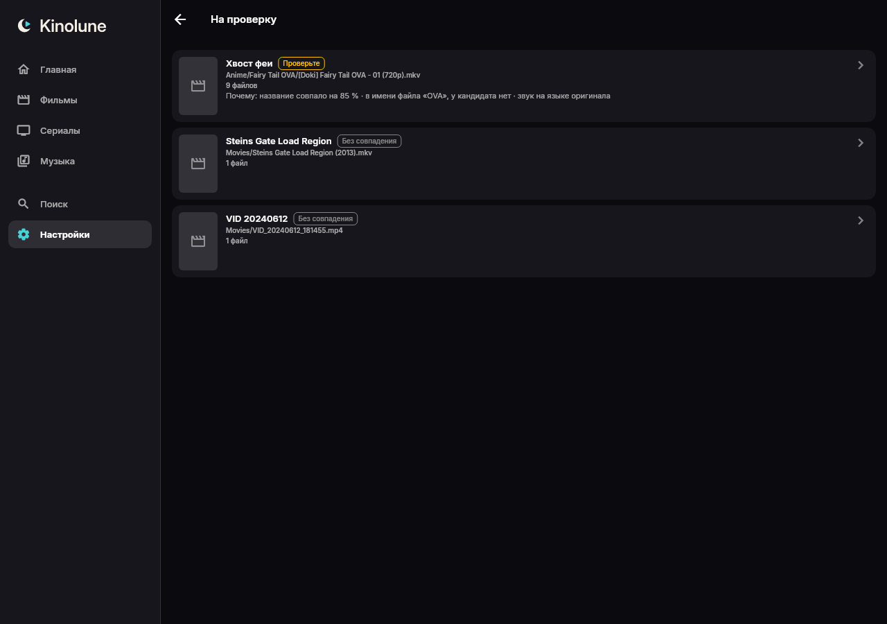
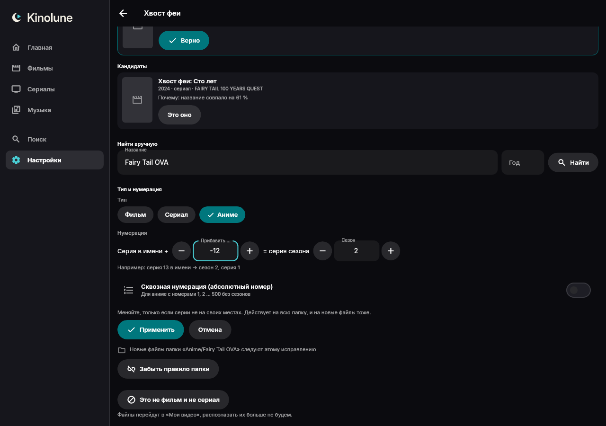

<!-- SPDX-License-Identifier: MPL-2.0 -->

# Распознавание и как его исправить

После сканирования Kinolune сам решает, что лежит в каждой папке, и находит название, постер и описание. Выбирать тип заранее не нужно.

| Что нашлось | Куда попадает |
|---|---|
| Фильм | «Фильмы» |
| Серии сериала или аниме | «Сериалы» |
| Музыка | «Музыка» |
| Аудиокниги (папки с главами, файлы m4b) | «Книги» |
| Ролики с телефона и камеры (`VID_20240612_181455.mp4` и т. п.) | «Мои видео» — без запросов в интернет |

Названия фильмов и сериалов ищутся в TMDB, аниме — по встроенной базе аниме, AniList и Shikimori, музыка — в MusicBrainz, аудиокниги — в Open Library.

## Как называть файлы, чтобы всё узнавалось сразу

Kinolune разбирает и «реальные» имена с релизными пометками, но чем проще имя, тем точнее результат:

```text
Фильмы/
  Тихая орбита (2024)/
    Тихая орбита (2024).mkv
    Тихая орбита (2024)-trailer.mkv     ← свой трейлер
    Extras/                              ← допматериалы
Сериалы/
  Лунное бюро/
    Season 01/
      Лунное бюро S01E01.mkv
      Лунное бюро S01E02.mkv
Аниме/
  Название/
    Название - 01.mkv                   ← сквозная нумерация тоже понимается
```

- **Год в скобках** помогает отличить фильмы с одинаковым названием.
- **Серии** — `S01E02`, `1x02` или номер серии в имени; папки `Season 1`, `Сезон 1`.
- **Допматериалы** — папки `Extras`, `Featurettes`, `Behind The Scenes`, `Deleted Scenes`, `Interviews`, `Trailers`, «Допматериалы», «Трейлеры» или суффиксы `-trailer`, `-featurette`, `-interview` у файла рядом с фильмом. Они показываются на странице фильма и не попадают в медиатеку отдельными фильмами.
- **NFO.** Если рядом с видео лежит `movie.nfo` или `<имя видео>.nfo` (у сериала — `tvshow.nfo` в папке сериала) с ID TMDB, IMDb, TVDB или AniDB, Kinolune берёт фильм именно по этому ID и не гадает по названию. Подходят NFO от Kodi, Jellyfin, Emby и ссылки вида `imdb.com/title/tt…` или `themoviedb.org/movie/…` в NFO релизов.
- **Диски.** Папки `BDMV`, `VIDEO_TS` и образы ISO распознаются как один фильм. Образы ISO пока не воспроизводятся — приложение объяснит это при попытке открыть.
- **Части фильма** (`CD1`, `CD2`, `part1`) склеиваются в один фильм, несколько файлов одного фильма становятся «версиями».

## «На проверку»: когда Kinolune не уверен

Если совпадение уверенное, фильм просто появляется в медиатеке. Если Kinolune сомневается, он показывает лучший вариант с пометкой «проверьте» и добавляет его в список **«На проверку»**. Если ничего похожего не нашлось, элемент попадает туда же с пометкой «Без совпадения».



Где найти:

- на главной — кнопка «Проверьте распознавание: N»;
- «Настройки → Медиатека и источники → На проверку»;
- на карточке фильма или сериала — полоса «Возможно, это не то: выберите вариант или подтвердите»;
- у постера в медиатеке — значок «?».

В строке списка написано, почему Kinolune сомневается («Почему: название совпало на 85 % · …»). Откройте строку:

- **«Верно»** — оставить как есть;
- **«Это оно»** у одного из кандидатов — выбрать его, постер и описание обновятся;
- **«Найти вручную»** — введите название (и год) и выберите результат;
- **«Это не фильм и не сериал»** — файлы уйдут в «Мои видео» и больше не будут распознаваться.

На карточке можно решить быстрее: нажмите постер кандидата прямо в полосе, «Верно» или «Другое…» для полной страницы.

## Исправить уже распознанное

Если фильм или сериал распознан неправильно, откройте меню постера («Изменить метаданные») или кнопку **«Исправить распознавание»** на карточке. Откроется та же страница, что в «На проверку».

### Тип и нумерация

На этой странице есть раздел «Тип и нумерация». Всё здесь действует на **всю папку**, включая файлы, которые появятся в ней позже.



- **«Тип»: «Фильм», «Сериал» или «Аниме»** — если папку определили не так.
- **«Нумерация»** — если серии стоят не на своих местах. Нажмите «Изменить нумерацию» и задайте фразу «Серия в имени + [N] = серия сезона [S]». Пример под полями сразу покажет результат: например, при сдвиге −12 и сезоне 2 «серия 13 в имени → сезон 2, серия 1». Для аниме с номерами 1…500 без сезонов включите «Сквозная нумерация (абсолютный номер)». Нажмите «Применить».

### Правило папки

Каждое ваше исправление Kinolune запоминает как **правило папки**: новые файлы в этой папке распознаются так же. На странице это видно строкой «Новые файлы папки «…» следуют этому исправлению». Кнопка «Забыть правило папки» отменяет его — новые файлы снова распознаются с нуля.

## «Это не то» в обзоре файлов

Если неправильно определён тип целой папки (например, музыкальные клипы попали в фильмы), откройте источник в «Обзор файлов» и нажмите **«Это не то»** у папки. Тип сменится сразу («Теперь здесь: …»), «Вернуть» в сообщении отменяет действие.

## Порядок серий

У некоторых сериалов и аниме несколько порядков серий. На странице сериала кнопка «Порядок TMDB» открывает выбор: «Порядок TMDB», «Абсолютный порядок» или «Порядок AniDB». Выбор запоминается для сериала. Порядок по умолчанию для всех сериалов — «Настройки → Сериалы → Порядок серий по умолчанию».

## Настройки метаданных

«Настройки → Метаданные»:

- **«Язык метаданных»** — «Как у интерфейса», «Русский» или «English». Названия и описания обновятся после следующего сканирования.
- **«Ключ TMDB API»** — ключ уже встроен в сборки с GitHub. Свой ключ нужен, только если вы собрали приложение сами или хотите пользоваться своим лимитом.
- **«Обновлять базу аниме»** — раз в сутки проверять новую версию базы аниме на GitHub (включено). «База аниме» показывает версию и кнопку «Проверить сейчас».
- **«Распознавать аниме по кадрам»** — **выключено по умолчанию**. Если включить, для аниме, которое не узналось по названию, до 10 кадров серии отправляются в сервис trace.moe. Имя файла и другие данные не передаются.

Ход распознавания виден в «Настройки → Медиатека и источники»: «Идёт распознавание», «Ждут распознавания: N» или «Всё распознано». Если сервис просит подождать, Kinolune так и пишет («Ждём TMDB: лимит запросов, N с») и продолжает сам.
