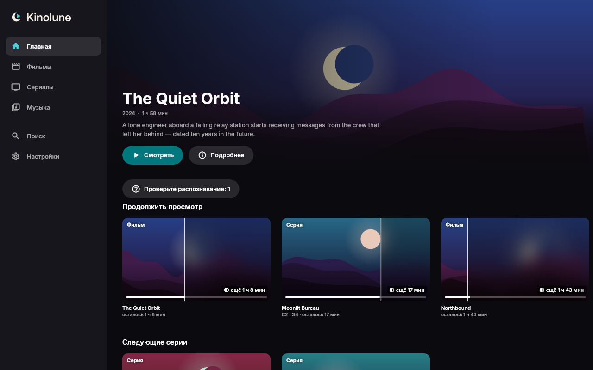

<!-- SPDX-License-Identifier: MPL-2.0 -->

# Медиатека, поиск и загрузки

## Разделы

На широком экране слева боковое меню, в узком окне — узкая панель, на телефоне — вкладки внизу, на ТВ — меню сверху. Разделы:

- **Главная** — то, что вы смотрите, и новое.
- **Фильмы** и **Сериалы** (на телефоне — вкладка «Библиотека» с переключателем).
- **Стримы** — Twitch; появляются, если включить их в настройках ([подробнее](08-twitch.md)).
- **Музыка** и **Книги** — книги видны, только когда в медиатеке есть аудиокниги ([подробнее](07-music-and-audiobooks.md)).
- **Личное** — [личные библиотеки](05-personal-and-files.md).
- **Поиск** и **Настройки**. На телефоне настройки открываются аватаром профиля в правом верхнем углу главной.

Повторное нажатие на открытый раздел возвращает к его началу.

## Главная

- Баннер сверху: «Смотреть» и «Подробнее» (у сериала — «Серии»). При наведении или фокусе на карточку ряда баннер переключается на неё.
- **«Продолжить просмотр»** — начатые фильмы, серии и записи Twitch с полосой прогресса и остатком времени. Нажатие продолжает с места остановки.
- **«Следующие серии»** — следующая серия после досмотренной.
- **«Избранное»**, **«Недавно добавленные фильмы»**, **«Недавно добавленные сериалы»**, закреплённые умные полки, ряды жанров.
- **«Мои видео»**, **«Музыка»**, **«Источники»** (карточка источника открывает его файлы).
- Если на другом вашем устройстве сейчас что-то играет, вверху появится «Играет на …» с кнопкой «Продолжить на этом устройстве».

Когда сканирование находит новые фильмы или серии, появляется уведомление с кнопкой «Открыть».

## Фильмы и сериалы

- **«Сетка»** или **«Список»** — выбор запоминается отдельно для фильмов и сериалов.
- **«Сортировка»**: по названию, недавно добавленные, по году, недавно просмотренные, длительность, моя оценка. Повторный выбор того же пункта меняет направление.
- **Фильтры**: «Не просмотрено», «Начатые», «Просмотрено», десятилетие, разрешение (SD…4K), HDR (HDR10, HDR10+, Dolby Vision, HLG), жанр. Внутри одной группы фильтры работают как «или», между группами — как «и». «Сбросить фильтры» снимает все.
- **Буквы справа** — быстрый переход по алфавиту при сортировке по названию.

Значки на постерах: «✓» — просмотрено, «◐» и полоса — начато, число — сколько серий сериала осталось, «Новое» — добавлено за 14 дней, «?» — стоит проверить распознавание.

### Меню постера

Правый клик, долгое нажатие, клавиша Menu (или Shift+F10), долгое нажатие OK на пульте:

- «Смотреть» — с сохранённого места; у сериала — начатая или первая непросмотренная серия;
- «Отметить просмотренным» / «Отметить непросмотренным» (для Jellyfin и Emby — и на сервере);
- «В избранное» / «Убрать из избранного»;
- «В плейлист» — в существующий или новый плейлист;
- «Изменить метаданные» — см. [«Распознавание»](03-recognition.md);
- «Скачать» — офлайн-копия (только для сетевых источников, см. ниже);
- «Перенести в личные медиа» — см. [«Личное»](05-personal-and-files.md).

Удалить фильм из медиатеки нельзя: Kinolune не трогает ваши файлы. Уберите файл из источника или удалите источник.

## Страница фильма и сериала

- **«Смотреть»** / **«Продолжить с 12:34»** и **«С начала»**. Строка «Остановились на … · 2 дня назад» показывает, на каком устройстве вы остановились.
- Если у фильма несколько файлов (например, 1080p и 4K), Kinolune спросит, какую версию играть. Булавка «Играть эту версию по умолчанию» запоминает выбор.
- **«В избранное»**, **«Трейлер»**, **«Исправить распознавание»**.
- «Актёры и съёмочная группа», «Дополнительные материалы», «Входит в «…»» (другие фильмы коллекции), «Техническая информация» (контейнер, кодеки, дорожки).
- У сериала: сезоны («Спецвыпуски» — последними), список серий с отметками просмотра, «Скачать сезон», выбор порядка серий.

**Скрывать спойлеры** («Настройки → Сериалы») — размывает описания и кадры серий, которые вы ещё не начали.

## Поиск

Начните вводить название, год, исполнителя или альбом — результаты появляются сразу, по группам «Фильмы», «Сериалы», «Эпизоды», «Музыка». Недавние запросы хранятся на устройстве, у каждого профиля свои; их можно удалить по одному, кнопкой «Очистить историю» или в «Настройки → Конфиденциальность».

На ТВ текст можно набрать на сопряжённом телефоне ([подробнее](10-devices-and-tv.md#ввод-текста-с-телефона)). На Android TV работает голосовой поиск: «найди … в Kinolune».

## Плейлисты

«В плейлист» в меню постера: выберите плейлист или создайте новый. Сериал добавляется всеми сериями. Плейлисты музыки описаны в [«Музыка»](07-music-and-audiobooks.md).

## Загрузки для просмотра без сети

Фильмы, серии и музыку из **сетевых** источников (SMB, WebDAV, SFTP, FTP, Jellyfin, Emby, Subsonic) можно скачать на устройство, например перед поездкой.

1. На странице фильма или серии нажмите «Скачать» (у сериала — «Скачать сезон», у альбома — «Скачать альбом»). Если у фильма несколько версий, выберите, какую скачать.
2. Ход загрузки — на кнопке («Загрузка 45 %», «Загружено») и в «Настройки → Загрузки → Загрузки». Там же «Пауза», «Продолжить», «Отменить», «Повторить».
3. Без сети скачанный фильм открывается и играет из копии.

Настройки загрузок: «Папка загрузок» (на компьютере её можно сменить), «Только по Wi-Fi», «Удалять просмотренное» (сразу, через 1, 7 или 30 дней, или никогда). На Android загрузка продолжается при закрытом приложении: в уведомлении видны прогресс и кнопки. В режиме энергосбережения загрузки приостанавливаются.

«Удалить загрузку» удаляет только копию на устройстве — в медиатеке фильм остаётся и играет из источника.
