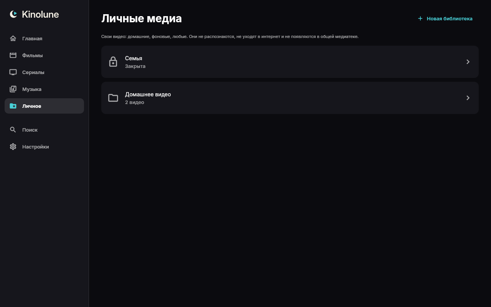
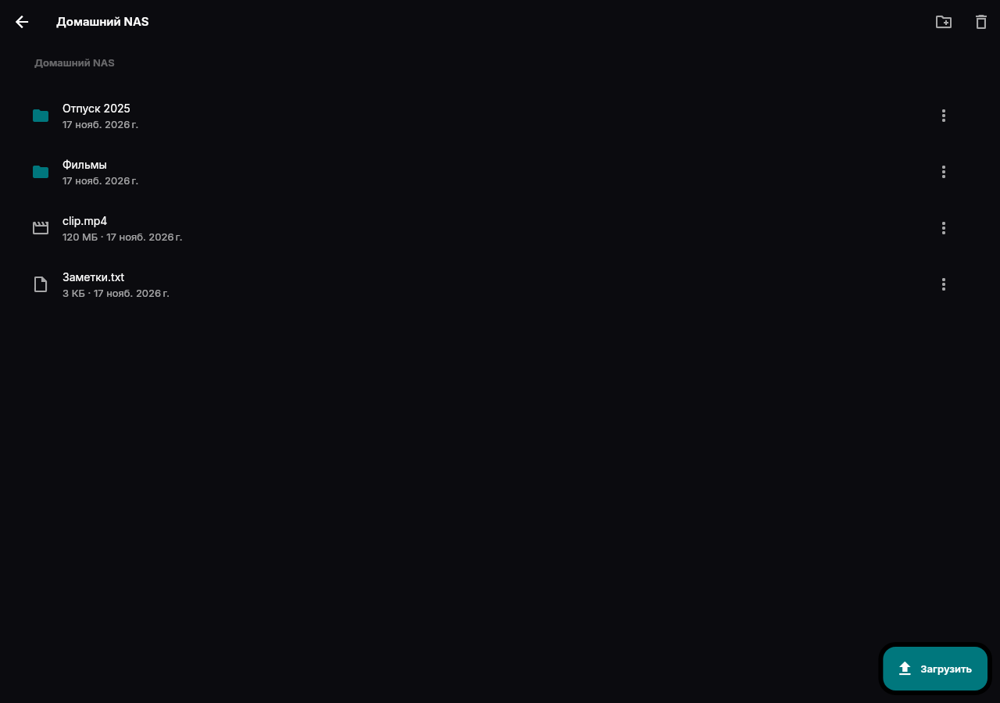

<!-- SPDX-License-Identifier: MPL-2.0 -->

# «Личное», «Мои видео» и файлы

## «Мои видео»

Ролики с телефонов и камер Kinolune определяет сам и показывает отдельно — в ряду **«Мои видео»** на главной и на странице «Мои видео» («Все» в конце ряда). Для них не ищутся названия в интернете, а прогресс не попадает в «Продолжить просмотр».

«Мои видео» видны всем профилям. Чтобы спрятать папку роликов, откройте меню ролика (долгое нажатие, правый клик, клавиша Menu или долгое OK на пульте) → **«Скрыть папку в Личное»** и выберите личную библиотеку.

## «Личное»

«Личное» — личные библиотеки для домашнего и любого другого видео. Их содержимое:

- не распознаётся и не уходит в интернет;
- не появляется в общей медиатеке, поиске и «Продолжить просмотр»;
- место остановки хранится только в этой библиотеке и не передаётся на другие устройства;
- может быть закрыто PIN-кодом или паролем.

### Создать библиотеку

1. Раздел «Личное» → **«Новая библиотека»**.
2. Введите название и выберите «Замок»: «Нет», «PIN-код» (по умолчанию) или «Пароль» (не короче 6 символов).
3. «Сохранить». Библиотека откроется сразу.

### Добавить видео

- **«Добавить папку»** (меню ⋮ библиотеки) — выберите источник и папку, затем «Выбрать эту папку». Видео остаются на месте, библиотека только показывает их.
- **«Перенести в Личное»** в «Обзоре файлов» источника — у папки или весь источник целиком. «Вернуть в медиатеку» отменяет.
- **«Перенести в личные медиа»** в меню постера фильма — фильм уходит из медиатеки в выбранную библиотеку. «Вернуть в медиатеку» в меню видео возвращает его.
- **«Загрузить»** — загрузить файлы с этого устройства (см. ниже).
- **«Поделиться → Kinolune»** из галереи или другого приложения Android — файлы загружаются в первую открытую личную библиотеку.

### Внутри библиотеки

- Ряд «Продолжить» — начатые видео этой библиотеки.
- Поиск по названию, фильтры по категориям, тегам и оценке, «Сортировка».
- Меню видео (⋮ или долгое нажатие): «Смотреть», «Оценка» (1–5 звёзд), «Теги», «Категории», «Убрать из «Продолжить»», «Вернуть в медиатеку».
- Меню библиотеки: «Добавить папку», «Переименовать», «Сменить замок», «Удалить библиотеку». При удалении файлы остаются на месте.
- «Закрыть» — снова запереть библиотеку с замком.

### Приватность

- Когда приложение уходит в фон, все библиотеки закрываются, а экран прячется за заглушкой — в списке недавних приложений превью нет.
- На Android, пока открыта личная библиотека, система запрещает снимки и запись экрана.
- Слишком много неверных PIN или паролей подряд — ввод блокируется на время.

## Файлы

Для источников, в которые можно записывать (папка на устройстве, SMB, WebDAV, SFTP, FTP), есть файловый вид — как в Nextcloud. Откройте его кнопкой **«Файлы»** в «Обзоре файлов» источника или в личной библиотеке.

- **«Загрузить»** — на компьютере сразу открывается выбор файлов, на телефоне и ТВ — «Из галереи» или «Из файлов». Можно выбрать несколько. Загрузка идёт в фоне, очередь видна внизу экрана; прерванная загрузка продолжается с места обрыва.
- **«Новая папка»**.
- Меню файла ⋮: «Переименовать», «Переместить в…», «Копировать в…», «Удалить». На компьютере файл можно перетащить мышью на папку или на звено пути вверху.
- Если имя уже занято, Kinolune спросит один раз на все файлы: «Оставить оба» (по умолчанию), «Заменить» или «Пропустить».

### Корзина

«Удалить» не стирает файл, а кладёт его в **корзину** источника; сообщение «… в корзине» с кнопкой «Отменить» возвращает его сразу. Корзина (значок в правом верхнем углу) хранит удалённое 30 дней: там можно «Восстановить» файл или «Удалить навсегда». «Очистить» стирает всё содержимое корзины без возможности отменить.

### Личное хранилище

Куда загружаются файлы в «Личное», выбирается в «Настройки → Личное хранилище»: «Автоматически» (первый источник с правом записи, иначе папка на этом устройстве), конкретный источник или «На этом устройстве». Если писать некуда, Kinolune попросит добавить источник с правом записи.
