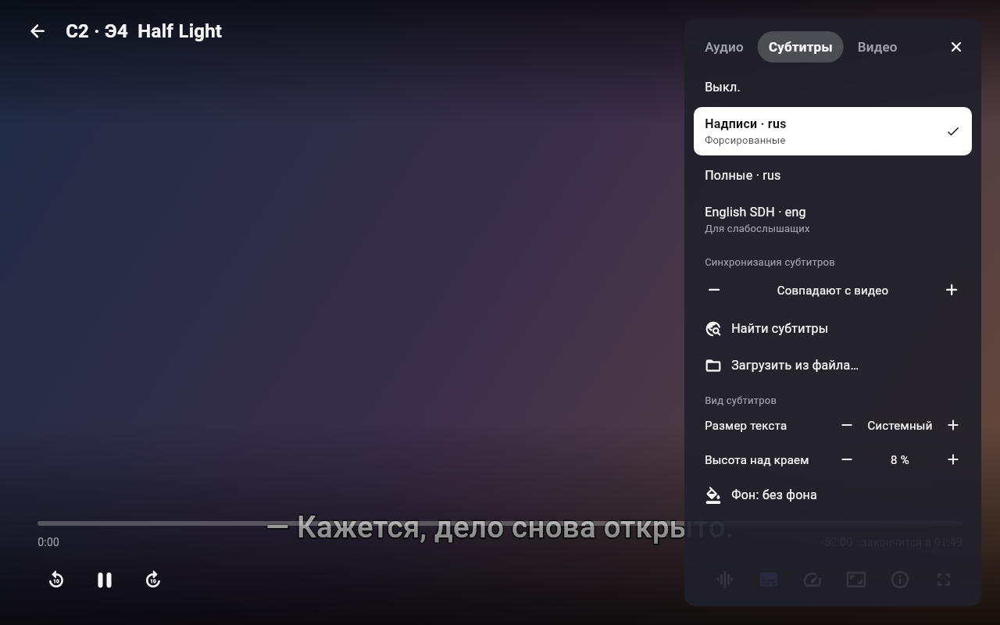
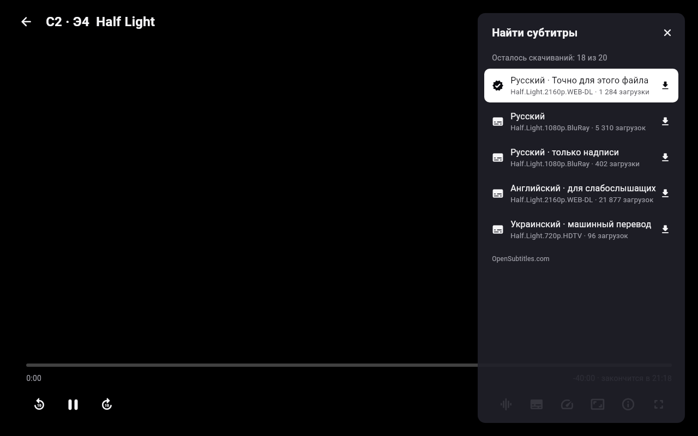

<!-- SPDX-License-Identifier: MPL-2.0 -->

# Просмотр: дорожки, субтитры, трейлеры

Плеер открывается кнопкой «Смотреть» и продолжает с места остановки. Место сохраняется каждые несколько секунд, на паузе и при выходе, поэтому после закрытия теряется не больше 10 секунд.

## Управление

Коснитесь видео или пошевелите мышью — появится панель управления; при воспроизведении она скрывается сама через 4 секунды.

| Действие | Мышь и сенсор | Клавиатура и пульт |
|---|---|---|
| Пауза / продолжить | кнопка в центре внизу | Пробел, OK, Play/Pause |
| Перемотка на шаг | кнопки ±10 с, двойное касание слева или справа | ← / → |
| В любую точку | нажать или потянуть шкалу (над ней — кадр-превью) | — |
| Глава назад / вперёд | панель «Главы» | PageUp / PageDown, медиаклавиши «предыдущий / следующий» |
| Громкость / яркость (телефон) | провести вверх-вниз справа / слева | M — выключить звук |
| Увеличение | щипок двумя пальцами | Z — режим масштаба |
| Скорость | панель «Скорость» | [ и ] |
| 2× пока держите | долгое нажатие на видео | — |
| Полный экран (компьютер) | двойной клик по центру | F |
| Информация, статистика | кнопка «Информация» | I, S |
| Выйти | стрелка слева вверху | Esc, «Назад» |

Шаг перемотки (5, 10, 30 с…) меняется в «Настройки → Воспроизведение → Шаг перемотки».

На Android видео уходит в окно «картинка в картинке» при нажатии «Домой». Управление есть на экране блокировки и в уведомлении; кнопки гарнитуры работают.

## Звук, субтитры и видео

Кнопки внизу справа открывают панель с вкладками **«Аудио · Субтитры · Видео»**. На компьютере она справа, на телефоне — шторка снизу, на ТВ — сверху.

- **Аудио** — выбор дорожки (с пометками «Комментарий», «Тифлокомментарий»), «Задержка звука» шагом 50 мс, «Свести в стерео», «Сабвуфер (LFE) в стерео», «Нормализовать сведение», «Усиление громкости».
- **Субтитры** — «Выкл.» или дорожка (пометки «Форсированные», «Для слабослышащих»), «Синхронизация субтитров» шагом 100 мс, «Найти субтитры», «Загрузить из файла…», «Вид субтитров» (размер, высота над краем, фон).
- **Видео** — выбор видеопотока, если их несколько, и режимы масштаба: «Вписать», «Заполнить», «Растянуть», пропорции.

Выбранные звук, субтитры и задержка **запоминаются для сериала**: следующая серия начнётся с них.

### Какие дорожки выбираются сами

«Настройки → Воспроизведение → Языки и звук»:

- «Язык звука»: «Авто (язык интерфейса, иначе оригинал)», «Оригинал» или «Выбранные языки» (в порядке предпочтения).
- «Язык субтитров» и «Показывать субтитры»: «Авто: для речи на других языках», «Всегда», «Только форсированные», «Выкл.».
- «Субтитры для глухих и слабослышащих (SDH)»: «Как в системе», «Предпочитать», «Избегать».
- Сведение в стерео, нормализация, LFE и усиление — те же, что в панели.

### Внешние субтитры

Файлы `.srt`, `.ass` и другие рядом с видео (или в папке `Subs`) подхватываются сами. Другой файл можно выбрать кнопкой «Загрузить из файла…».

### Стиль субтитров

«Настройки → Воспроизведение → Стиль субтитров». По умолчанию включён «Системный стиль субтитров» — как в настройках устройства. Выключите его, чтобы выбрать размер, шрифт, цвет, фон и положение. «Заменять стили ASS» показывает стилизованные субтитры (аниме, караоке) простым текстом в вашем стиле. «Яркость поверх HDR-видео» делает белые субтитры в HDR не слепящими.

## Поиск субтитров в интернете

Если подходящих субтитров нет, нажмите **«Найти субтитры»** во вкладке «Субтитры». Kinolune ищет на OpenSubtitles.com по отпечатку файла и ID фильма; вверху списка — варианты «Точно для этого файла». Нажмите вариант — субтитры скачаются и включатся.

OpenSubtitles ограничивает число скачиваний в сутки; остаток показан над списком. Без входа лимит считается на адрес вашей сети. Чтобы получить свой лимит, войдите: «Настройки → Воспроизведение → Стиль субтитров → Субтитры из интернета», «Логин OpenSubtitles», «Пароль», «Сохранить и проверить». Поиск работает для фильмов и серий медиатеки; для музыки и личных видео его нет.

## Пропуск заставки и следующая серия

Kinolune находит заставки, пересказы и титры, сравнивая серии сезона (или по главам «Opening» и «Credits»), а также берёт готовые метки Plex и Jellyfin. «Настройки → Воспроизведение → Пропуск заставки и титров»:

- «Показывать кнопку» — внизу справа «Пропустить заставку», «Пропустить пересказ», «Пропустить титры»;
- «Пропускать через 3 секунды» или «Пропускать сразу»;
- «Выкл.».

В конце серии появляется карточка «Далее» с отсчётом: «Смотреть сейчас» или «Отмена». Если выключить «Непрерывный просмотр», карточка останется, но без отсчёта.

## Трейлеры

На странице фильма или сериала кнопка **«Трейлер»** играет трейлер. Kinolune ищет его в таком порядке:

1. Ваш файл трейлера рядом с фильмом (`-trailer`, папка `Trailers`).
2. Трейлер с вашего медиасервера (Jellyfin, Emby).
3. Трейлер YouTube или Vimeo из TMDB — во встроенном официальном плеере сайта, без скачивания. Там, где встроенного плеера нет (Windows, Linux), трейлер открывается в браузере.

Свой трейлер через полторы секунды начинает играть без звука в шапке страницы. «Настройки → Трейлеры»:

- «Трейлер в баннере»: «Всегда», «Только Wi-Fi», «Никогда»;
- «Трейлеры из интернета» — выключите, если не хотите обращений к YouTube и Vimeo; останутся только свои трейлеры и трейлеры сервера.

При системной настройке «Убрать анимацию» и в режиме энергосбережения Android трейлер в шапке сам не запускается.

## Если файл не играет

Образы дисков ISO и некоторые редкие форматы пока не воспроизводятся — Kinolune покажет «Этот файл не воспроизводится» с объяснением. Остальное — в [«Если что-то не работает»](12-troubleshooting.md).
