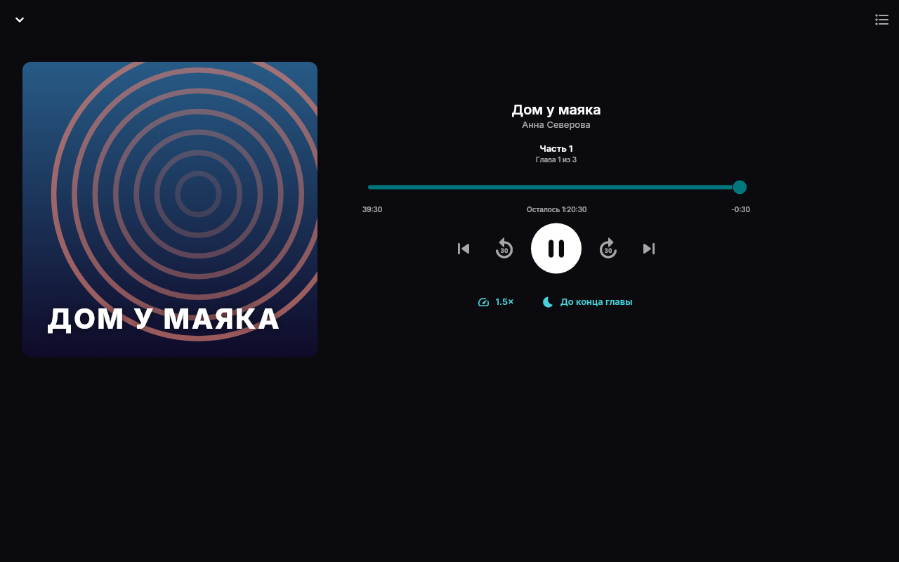

<!-- SPDX-License-Identifier: MPL-2.0 -->

# Музыка и аудиокниги

## Музыка

Музыка из ваших источников появляется в разделе «Музыка» сама. Альбомы, исполнители и обложки берутся из тегов файлов, недостающее (жанры, лейбл, сведения об исполнителе, обложки) — из MusicBrainz и Cover Art Archive.

- **«Главная»** — «Недавно прослушанное», «Часто слушаете», «Миксы» («Из избранного», «Микс: <жанр>»), «Недавно добавленные альбомы», «Артисты».
- **«Медиатека»** — «Плейлисты», «Артисты», «Альбомы», «Треки», «Жанры», «Композиторы», «Папки». Чипы «Загружено», «Hi-Res», «Lossless» фильтруют список.
- **«Перемешать всё»** — вся музыка в случайном порядке.

Нажатие на трек играет весь список с этого трека. Меню трека (долгое нажатие, правый клик, Shift+F10): «Играть следующим», «Добавить в очередь», «Добавить в плейлист».

### Плейлисты

- **«Новый плейлист»** — пустой плейлист, треки добавляются из меню трека.
- **«Импорт M3U»** и **«Экспорт M3U»** — обмен плейлистами с другими плеерами.
- **«Новый умный плейлист»** — плейлист по правилам: жанр, год, число прослушиваний, формат (например, «Жанр содержит джаз» и «Формат равно Lossless»). Можно задать «Все правила» или «Любое правило», сортировку и предел числа треков. Новые треки попадают в него сами.
- «Скачать плейлист» и «Скачать альбом» — офлайн-копии для сетевых источников.

### Сейчас играет

Внизу экрана — мини-плеер; нажатие открывает «Сейчас играет»: обложка, перемотка, «Перемешивание», «Повтор» (всех / одного), вкладки **«Очередь»** и **«История»**. Треки в очереди можно перетаскивать, смахивать или убирать крестиком; «Сохранить как плейлист» сохраняет очередь.

Очередь, позиция и режимы сохраняются после перезапуска; у каждого профиля своя очередь. Когда вы включаете видео, музыка встаёт на паузу, а после плеера можно нажать «Продолжить».

На Android музыка играет в фоне, с уведомлением и управлением на экране блокировки, и продолжается, даже если смахнуть приложение из «Недавних».

«Настройки → Музыка»: «Без пауз между треками» и «Выравнивание громкости (ReplayGain)» — по треку, по альбому или автоматически.

## Аудиокниги

Раздел **«Книги»** появляется сам, когда в медиатеке находятся аудиокниги:

- папка с частями книги (подпапки `CD1`, «Часть 1» и т. п. относятся к той же книге);
- файл с главами (`.m4b`).

Лучше всего узнаются папки вида `Автор - Название (Чтец)` и книги серий `Серия/02 - Название`. Описание и обложку Kinolune ищет в Open Library, если своей обложки в папке нет. Если книга не нашлась уверенно, на странице будет «Не уверены, что это за книга…», а данные из интернета не подставятся.

- **«Продолжить слушать»** — начатые книги с остатком времени.
- Страница книги: автор, чтец, серия, главы. «Слушать», «Продолжить с 40:00» или «Слушать снова».
- Плеер книги: переход по главам, «Назад на 30 секунд» и «Вперёд на 30 секунд», **«Скорость»** (0,5×–3×, запоминается), **«Таймер сна»** (5–60 минут или «До конца главы»), список «Главы».

Место в книге сохраняется само. Книга и музыка не играют одновременно, и аудиокниги не попадают в раздел «Музыка».
