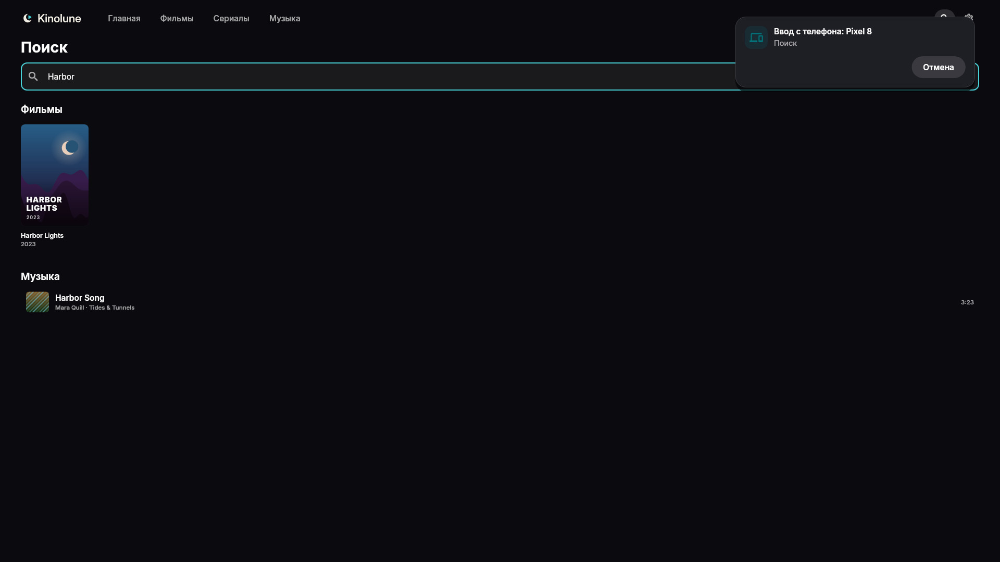

<!-- SPDX-License-Identifier: MPL-2.0 -->

# Устройства: синхронизация, ТВ и пульт

## Синхронизация между устройствами

Kinolune на телефоне, компьютере и ТВ можно связать. Связанные устройства обмениваются **по домашней сети**, без облака:

- местом остановки, «Продолжить просмотр» и отметками «просмотрено»;
- категориями, тегами и оценками;
- профилями;
- сетевыми источниками, у которых включено «Синхронизировать с моими устройствами» (пароль — только если включено «Передавать пароль»).

Сами файлы не копируются: каждое устройство читает их из источника.

### Связать два устройства

Оба устройства должны быть в одной сети.

1. На первом устройстве: «Настройки → Устройства» → **«Показать код»**. Появятся QR-код и код из 6 цифр (действует несколько минут).
2. На втором устройстве: «Настройки → Устройства» → введите код в поле «Код из 6 цифр» и нажмите «Подключить». На телефоне или планшете можно нажать «Сканировать QR-код» и навести камеру.
3. Оба устройства покажут, что связаны.

То же можно сделать на последнем шаге мастера первого запуска («Сопрячь устройство»).

В списке «Связанные устройства» видно, какие устройства «В сети». «Отвязать» убирает другое устройство, «Выйти» отключает синхронизацию на этом устройстве (ваш прогресс на нём остаётся).

### Продолжить на другом устройстве

- Если на другом устройстве сейчас что-то играет, на главной появится «Играет на …» → **«Продолжить на этом устройстве»**.
- Если во время просмотра другое устройство ушло дальше, Kinolune предложит «Перейти к ЧЧ:ММ?».
- Если то же видео включили на другом устройстве, здесь оно встанет на паузу («Пауза: продолжается на …»). Выключить: «Настройки → Воспроизведение → Пауза при переходе на другое устройство».

## Управление с пульта (Android TV, Google TV)

- Верхнее меню: ← / → переключают разделы, ↓ — к содержимому.
- OK — открыть или нажать, «Назад» — на шаг назад; из корня раздела — в меню, с главной — выход.
- **Долгое нажатие OK** (или клавиша Menu) на карточке — меню карточки: «Смотреть», «В избранное», «Изменить метаданные» и другие.
- На странице фильма фокус сразу на «Смотреть»; «вверх» с верхнего ряда кнопок открывает трейлер на весь экран.
- В плеере: OK — пауза, ← / → — перемотка, ↓ — к кнопкам, Info — сведения о файле.
- Уведомление на экране фокус не забирает: ↑ с верхнего края страницы переходит на его кнопки.

### Ввод текста с телефона

Набирать название пультом долго. Если с ТВ связан телефон с Kinolune, задержите фокус на поле поиска, адреса или пароля — на телефоне само откроется окно «Ввод на …» (или придёт уведомление «Ввести с телефона»). Текст появляется на ТВ по мере набора, «Готово» на телефоне выполняет поиск. Пароль уходит зашифрованным и на телефоне не сохраняется.

Без связанного телефона OK на поле открывает экранную клавиатуру ТВ.

### Интеграция с Android TV

- Начатые фильмы и следующие серии появляются в системном ряду «Продолжить просмотр» / «Play Next» лаунчера. Нажатие на карточку продолжает просмотр. Убранная из ряда карточка вернётся, только когда вы снова посмотрите это название.
- При смене профиля ряд показывает «Продолжить» нового профиля.
- Голосовой поиск «найди … в Kinolune» открывает «Поиск» с результатами.

## Компьютер: клавиатура и мышь

- Tab / Shift+Tab и стрелки ходят по всем элементам, Enter или Пробел — нажать, Esc — назад.
- Правый клик или Shift+F10 — меню элемента.
- F6 — к кнопкам уведомления на экране.
- Kinolune работает одной копией: повторный запуск выводит открытое окно на передний план.
- «Открыть с помощью → Kinolune» на видео- или аудиофайле открывает его в плеере.
- На macOS есть меню в строке меню: «Файл → Источники…» ⌘O, «Файл → Поиск» ⌘F, разделы ⌘1…⌘7 в меню «Вид», «Воспроизведение → Воспроизвести/пауза» ⌘P и другие.

### Ссылки kinolune://

Ссылки открывают Kinolune из браузера, ярлыка или скрипта:

| Ссылка | Что открывает |
|---|---|
| `kinolune://search?q=текст` | «Поиск» с запросом |
| `kinolune://item/<id>` | Страницу фильма или сериала |
| `kinolune://play/<id>` | Воспроизведение с сохранённого места |
| `kinolune://channel/<login>` | Канал Twitch (если «Стримы» включены) |

Если включена блокировка, сначала появится экран PIN.
